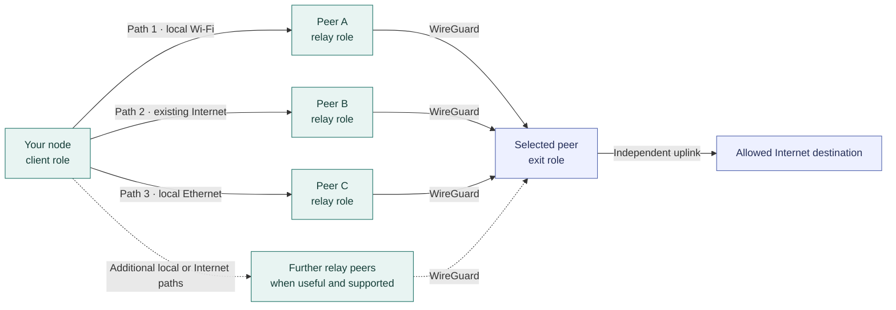
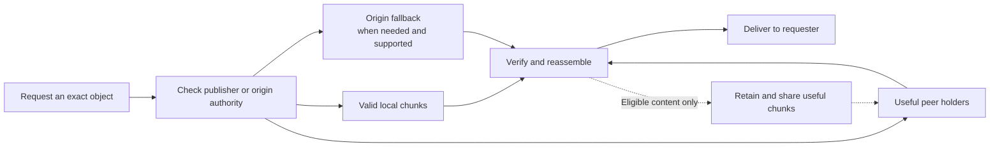
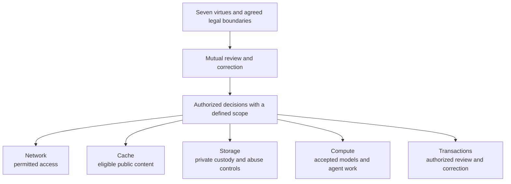

# Project VOLPAROSSA

**Useful digital tools, built on resources we share.**

Keeping in touch, looking after your files and getting help from AI often means relying on
separate services—or running their backends yourself. VOLPAROSSA is building a shared,
participant-operated foundation for open-source applications: **connectivity, reusable content,
private storage and cooperative computation**, with one core coordinating the work.

The goal is practical choice: familiar applications supported by infrastructure people can
inspect, contribute to and help improve. A modest device should be an entry point to shared
capabilities. Making that useful, dependable and safe is the engineering work ahead.

One concrete result: [installed Overmorrow Android retrieved real forecasts through peers](https://github.com/VOLPAROSSA/volparossa/actions/runs/38717988016)
in an emulator, then refreshed from cache. The broader network and application family remain
in development; there is no supported end-user release.

[**See what works**](#development-status) ·
[**Build an integration**](#developing-volparossa) ·
[**Support the shared work**](docs/community/SUPPORTING.md)

The architecture is a **DICN — Decentralized Intelligent Cooperative Network**.

[Explore the layers](#five-layers-in-one-network) ·
[Applications](#one-core-multiple-applications) ·
[7 Virtues](#governed-by-7-virtues) ·
[Development status](#development-status) ·
[Documentation](docs/README.md) ·
[FAQ](docs/FAQ.md) ·
[Community](docs/community/OVERVIEW.md) ·
[Support](docs/community/SUPPORTING.md) ·
[Contribute](CONTRIBUTING.md) ·
[Code of Conduct](https://github.com/VOLPAROSSA/.github/blob/main/CODE_OF_CONDUCT.md) ·
[Accessibility](https://github.com/VOLPAROSSA/.github/blob/main/ACCESSIBILITY.md) ·
[Discussions](https://github.com/VOLPAROSSA/volparossa/discussions)

> **Development preview · Initial core target: Debian 13 amd64 · GPL-3.0-only**
>
> Real working milestones exist, but the expanded alpha is not complete and there is no
> supported end-user release. This repository contains the core/daemon; the application
> integrations have their own repositories. Do not use the development build to protect
> sensitive traffic or as the only copy of important data.

## Why a DICN

- **Give applications a shared foundation.** A messaging app, a photo library and a coding
  assistant need different features, but can reuse connectivity, storage and task coordination.
  The aim is to let an improvement to a shared service benefit several integrations instead
  of rebuilding the same infrastructure for each one.
- **Make more possible from a modest device.** Shared models and suitable work on other
  participants' devices could extend what one device can do. Useful quality, latency and
  resource cost still need measurement; confidential execution of private tasks on peers
  remains unfinished.
- **Make control inspectable.** Open code, scoped application permissions and explicit
  relay/exit boundaries give contributors concrete behavior to examine and challenge.
  Replaceable discovery contacts are introductions, not central authorities. These choices
  do not create an unconditional privacy or availability guarantee.
- **Share responsibilities as well as benefits.** Joining is voluntary. Production consumers
  contribute nonzero relay capacity, plus exit service when they have an independent Internet
  uplink. Resource budgets must give the owner's activity priority. Sponsorship is separate
  from these contribution duties.

One compatible background core should serve several applications without duplicating the
network. Closing a frontend should not end the node's accepted responsibilities. Application
access and explicitly chosen system-wide operation remain separate permissions.
[Shared-service design](docs/architecture/APPLICATION_LIFECYCLE.md)

## Development status

**Development evidence through 20 October 2026.** Working milestones exist across all five
layers, but they do not yet form a complete, supported service. The distinction matters
especially for private data and applications that depend on several layers at once.

| Area | Demonstrated in scoped trials | Important remaining boundary |
| --- | --- | --- |
| Network and cache | Protected WireGuard routes carrying genuine MPTCP, UDP/MASQUE and Multipath QUIC traffic, including three-path trials; verified peer retrieval, selected HTTPS/DNS sharing and publication while the original publisher is offline. | This is not automatic caching of arbitrary HTTPS traffic or proof on every device and network. |
| Weather applications | Real weather, precipitation and particulate forecasts displayed and refreshed in Drizz.li and Overmorrow web clients; on-demand retrieval, refresh and background/resume in installed Overmorrow Android in an emulator. | Web trials obtain the first products before opening the UI. Expiry with real products, physical phones and iOS remain open. |
| Private storage | Fragment storage and provider-loss recovery; separate application trials include native Signal backup export/import, encrypted Image snapshots and OpenCloud file recovery. | The joined Image/Cloud publication, maintenance, repeated restore and deletion lifecycle is not yet accepted. Automatic reciprocal accounting and safe capacity reduction remain unfinished. |
| Compute and Code | Actual adapter training and reuse, public tasks on peer workers, selected model-review flows and an OpenCode model-driven read/edit/test task. | A successful bounded task is not general coding reliability. Confidential execution of private tasks on other people's devices remains unfinished. |
| Transactions | Signed TEST-unit transfers across four validators, conflicting-spend rejection, partitions, rejoining and replay without a second debit. | Fixed membership and fictitious assets; not live payments, external settlement or a Bank-to-distributed-ledger integration. |

[Citizen](https://github.com/VOLPAROSSA/volparossa-citizen) separately provides an executable
referendum-procedure simulation with fictional identities, not verified real-person voting
or recognized public authority. The [application guide](docs/applications/APPLICATIONS.md)
explains the scope of all ten integrations.

The [OpenCode trial](https://github.com/VOLPAROSSA/volparossa-code/actions/runs/38824828727)
completed its coding task in about **37 minutes**. The Code integration and native core
backend are now on their respective `main` branches. The trial remains bound to its
original pinned core revision; the newly integrated core has passed source checks,
not a repeat model trial. It demonstrates a local model-driven workflow, not competitive
performance, general coding reliability or confidential execution on other people's devices.

### Current integration work

The next shared dependencies are **private-storage maintenance with Image/Cloud** and
**protected peer computation**, while preserving the demonstrated coding workflow.
The [ordinary-expiry trial](https://github.com/VOLPAROSSA/volparossa/actions/runs/39081968944)
fails its required acceptance step. The [earlier Cloud consumer failure](https://github.com/VOLPAROSSA/volparossa/actions/runs/38917106698)
and unconfirmed remote cleanup remain separate; ordinary expiry has not been established
as their cause. Joined publication, repair, repeated restore and deletion remain open.

The [latest public-model guest trial](https://github.com/VOLPAROSSA/volparossa/actions/runs/39082065142)
passes contracts but fails public-model execution. Its retained artifact identifies an
export inventory pathname rejection, with the exact pathname and failing rule still
unknown. Public model execution and confidential private workloads remain unproven.
A public guest trial does not establish confidential hardware or authorize private tasks.

Complete applications, dependable shared reasoning, the full immune system and authorized
automatic software updates also remain in development. The
[execution plan](docs/IMPLEMENTATION_STATUS.md#execution-priorities-and-next-milestones)
tracks the current blockers and next usable milestones without treating feature branches
as released functionality.

These results belong to their recorded revisions and test conditions. The original
[A01–A15 transport acceptance run](https://github.com/VOLPAROSSA/volparossa/actions/runs/34047766913)
is a historical checkpoint, not certification of every later change.
[Detailed status and evidence](docs/IMPLEMENTATION_STATUS.md) keeps passing results,
failed trials and remaining work together. An open feature branch is not automatically
part of `main`.

<a id="four-layers-one-network"></a>

## Five layers in one network

The layers serve different purposes. **Public caching, private storage and message delivery
are not interchangeable**, and private data is not automatically training material.

| Layer | Purpose |
| --- | --- |
| Network | Connect participants through protected, useful parallel paths. |
| Cache | Reuse authorized content instead of repeatedly fetching the same bytes. |
| Storage | Retain encrypted private files with recovery copies and reciprocal capacity. |
| Compute | Share suitable work, models and learning across participating devices. |
| Transaction | Authorize and record transfers, distinguish settlement states and support accountable corrections. |

The **Transaction-layer currently operates only with fictitious test value**. It is separate
from reciprocal network participation and is not an operational payment or banking service.

<a id="one-network-many-paths"></a>

## Network-layer: One network, many paths

Multiple paths can work in parallel through different relays towards the same selected exit.
A path may begin over a direct local link or an existing Internet connection.



The diagram starts with your node in the client role: Path 1 reaches Peer A over local
Wi-Fi, Path 2 reaches Peer B over the existing Internet, and Path 3 reaches Peer C over
local Ethernet. These different relays each connect over WireGuard to the same selected
exit peer. The dotted route shows additional local or Internet paths through further
relays and WireGuard links to that same exit, when useful and supported. The exit's
independent uplink reaches the allowed Internet destination. Each normal path remains
client → exactly one relay → exit → destination, with payloads encrypted from client
to exit; local links do not permit a direct client-to-exit dataplane.

The diagram shows **several parallel routes**. Within each route, one WireGuard link
connects your node to its relay, and a second connects that relay to the selected exit.
These two links are sometimes called the route's **two legs**; that does not limit the
network to two parallel routes. Wi-Fi, Ethernet and Internet describe how a link reaches
the next peer, not a different number of legs.

Every route uses exactly one overlay relay. The payload remains encrypted from client
to exit across both links, and normal clients never connect directly to an exit's
dataplane. **Multipath** describes parallel routes, not a longer chain of overlay relays.

The relay knows the client and selected exit, but not the Internet destination. The exit
knows the destination and incoming relay, but not the client's public address.

| Traffic | Required transport |
| --- | --- |
| TCP | TLS 1.3 over genuine Linux MPTCP across selected relay paths. |
| General UDP | Protected single-path QUIC MASQUE through one relay. |
| Browser QUIC / HTTP/3 | Original datagrams inside MASQUE over genuine Multipath QUIC, with at least two active paths. |

Every participating consumer contributes relay capacity. A node with an independent
Internet uplink also contributes policy-limited exit service; a local-only node contributes
local connectivity and relay capacity. **Some reachable participant still needs a real
Internet uplink** to reach the Internet.

Installation does not enable participation automatically. Roles are functions of the same
software, not permanent classes of servers. The design grows useful connections within
available resources; shared bottlenecks mean more paths do not always mean more speed.
Direct-link tests include simulated radios, not proof on arbitrary phones or physical Wi-Fi hardware.

[Network architecture](docs/architecture/ARCHITECTURE.md) · [Local links and sharing](docs/network/LOCAL_LINK_NETWORK.md)

<a id="content-that-travels-with-the-network"></a>

## Cache-layer: Content that travels with the network

Eligible content travels as **verifiable chunks**. A requester can obtain missing pieces from
several peers, check them and reassemble the object. Participants can also pick up useful
extra pieces within their sharing budgets, helping content remain available beyond its
original source.



This is a retrieval flow, not a network-route diagram. Remote transfers still use protected
routes. Source selection should favor peers when they help, and use an authorized origin
fallback when content is missing, stale or better obtained there.

- **Public files and sites:** signed publications can remain reachable while valid peer copies exist.
- **HTTPS:** supported origin-authenticated modes share suitable public bytes without intercepting
  TLS or publishing private responses. This is not automatic caching of arbitrary websites.
- **DNS:** independently validated DNSSEC evidence can be reused until expiry, with a bounded
  private Unbound fallback at the exit.
- **Offline messages:** recipient-encrypted messages can wait at peers. Their delivery lifecycle
  is separate from retained backups; neither becomes public training content.

[Cache and publication design](docs/services/CONTENT_NETWORK_PROPOSAL.md) ·
[HTTPS usage](docs/development/OPERATIONS.md#https-checksum-file-downloads) ·
[DNS fallback](docs/network/UNBOUND_FALLBACK.md)

<a id="private-cloud-storage-separate-from-the-cache"></a>

## Storage-layer: Private cloud storage

Applications encrypt files **before** depositing them. The core spreads opaque fragments
across providers and reconstructs them for the authorized owner. Peers do not receive
recovery keys. Restoring a backup does not consume it.

Storage follows **one core-owned redundancy target: two copies**—per fragment in distributed
storage, or two complete copies in the supported legacy format. Repair can temporarily retain
extra copies; all retained copies count. Erasure coding is being considered, not claimed as implemented.

### Give as much usable space as you use

The agreed rule is **contribute at least the physical storage your data uses on other devices**,
including recovery copies and charged overhead.

- A **1 GB encrypted archive with two copies** uses roughly **2 GB plus overhead** remotely.
- You therefore make roughly **2 GB plus overhead available for others** on your device.
  Your own original file is separate; it is not counted as that contribution.
- When charged usage falls, the contribution target falls too. Other people's live fragments
  must be safely handed off before their occupied space is released.

Fragment storage and recovery have real development evidence. Automatic contribution
accounting, unattended repair, safe downscaling and full application synchronization remain
unfinished. The storage immune-system design must address abuse without exposing private
files; encrypted bytes and signed receipts alone cannot prove that content is permitted.

[Storage design, commands and limitations](docs/services/PRIVATE_STORAGE.md) ·
[Privacy questions](docs/FAQ.md#can-storage-peers-read-or-classify-my-files)

<a id="a-cooperative-brain"></a>

## Compute-layer: A cooperative brain

**Network cooperation and shared learning are the standard architecture**, not an extra
beside local AI. A modest device should be an access point and contributor—not the limit
on the intelligence available to its owner.

The core is intended to divide suitable work, combine agent results, reuse existing models
and train successors. It should learn from measured outcomes while considering memory,
compute, communication costs and the owner's activity. Suitable cache content can support
training, but missing authorized sources must remain fetchable: cache availability must
not decide which knowledge counts.

The agreed scope includes image and audio understanding, speech recognition and generation,
and natural spoken interaction through the same shared compute service. Agents should be
able to use permitted Internet sources for tasks, research, learning and maintenance, within
access rights and resource budgets. These are development goals, not completed capabilities.

Real development milestones include local adapter training, signed exchange and reuse,
public peer tasks and selected model-review/recovery loops. A bounded OpenCode task now
also demonstrates real model-driven reading, editing and testing through the core's local
CPU backend. **Successful execution is not the same as sound reasoning**; current small
models still make factual errors, and this coding result is not evidence of distributed
private computation.

Private network tasks also need protection against the executing device's operator—not
just encrypted transport. That required capability is unfinished. Current public-peer
experiments use explicitly authorized public data; local private inference is a fallback,
not completion of private network collaboration. Private prompts, files and results must
not silently enter shared models or public caches.

The scope also includes maintaining the project's repositories and automatically distributing
and installing authorized client updates. Independent review, release verification, staged
rollout and recovery remain required. Model output does not grant publication or installation
authority.

[Training, peer tasks and model profiles](docs/services/DECENTRALIZED_AGENTS.md) ·
[Software maintenance and updates](docs/services/REPOSITORY_MAINTENANCE.md)

## Transaction-layer: Ownership, payments and settlement

[VOLPAROSSA Bank](https://github.com/VOLPAROSSA/volparossa-bank) proposes
participant-owned portfolios, internal payments and connections to existing financial
systems. Portfolio weights use `ROIC × FCF-yield`, with both inputs nonnegative.
Reusable authorization, reservations, settlement status and dispute handling
belong in the core; investment methodology and presentation belong in Bank.

Implementation now includes durable signed TEST-unit reservations, transfers and cancellation,
with safe retries after restart. Bank connects recoverable payment intents to this owner-local
API. A separate core trial runs the Rust transaction application with four CometBFT validators:
conflicting spends are rejected and supply is conserved. A 3–1 split permits majority progress;
a 2–2 split halts new commits. Replay after a committed transfer does not debit twice.

That trial uses fixed membership and fictitious assets, not private financial processing,
independently verified client finality or a working Bank-to-distributed-ledger integration.
External settlement, decentralized price discovery and authorized financial recovery remain
unfinished. There is no live bank, securities trading service or financial gateway.

The immune system should help detect abuse without exposing everyone's finances. Corrections
must preserve the original record and have explicit authority; recovery cannot be guaranteed
after assets leave the system's control. Financial participation remains separate from
contributing network resources.

[Transaction-layer design and limits](docs/services/TRANSACTION_LAYER.md)

## One core, multiple applications

These are **integration targets with different completed milestones**, not finished
products. Each keeps its own repository and upstream identity; reusable network, storage
and compute coordination belongs in the core.

| Application | Foundation | Intended integration |
| --- | --- | --- |
| [Browser](https://github.com/VOLPAROSSA/volparossa-browser) | Firefox | Protected browsing, eligible caching and shared AI. |
| [Chat](https://github.com/VOLPAROSSA/volparossa-chat) | Signal | Encrypted messages, calls and private backups. |
| [Mail](https://github.com/VOLPAROSSA/volparossa-mail) | Thunderbird + Stalwart | Existing accounts, decentralized delivery and self-hosting. |
| [Code](https://github.com/VOLPAROSSA/volparossa-code) | OpenCode | Coding agents using core-managed models and collaboration. |
| [Image](https://github.com/VOLPAROSSA/volparossa-image) | Immich | Private photo/video libraries and recoverable state. |
| [Map](https://github.com/VOLPAROSSA/volparossa-map) | Organic Maps | Offline maps, shared distribution and traffic information. |
| [Weather](https://github.com/VOLPAROSSA/volparossa-weather) | Direct ECMWF/NOAA data; Drizz.li + Overmorrow clients | Shared forecasts, client delivery and measured forecast improvement. |
| [Cloud](https://github.com/VOLPAROSSA/volparossa-cloud) | OpenCloud | Private files, synchronization and server-independent access. |
| [Bank](https://github.com/VOLPAROSSA/volparossa-bank) | Core Transaction-layer | Participant-owned portfolios, payments and auditable corrections; fictitious-value implementation first. |
| [Citizen](https://github.com/VOLPAROSSA/volparossa-citizen) | Participation and voting research | Proposals and referenda alongside existing institutions; synthetic procedure simulation first. |

[Application scope and current boundaries](docs/applications/APPLICATIONS.md)

<a id="seven-virtues-seven-sins"></a>

## Governed by 7 Virtues

VOLPAROSSA takes its compass from seven Latin virtues and their opposing vices.
They are an **overarching values framework**, not an exhaustive checklist or a religious
membership test. Literal rules can miss unforeseen situations—or be followed while their
purpose is defeated. The intended direction is **principles → contextual reasoning →
reviewable decisions**.

The English translations and examples below explain the framework; they do not replace
it or define a person's moral worth.

- **Humilitas / Superbia** · *Humility / Pride*
  Acknowledge uncertainty, accept correction and avoid unsupported claims of authority.

- **Humanitas / Invidia** · *Humanity & Kindness / Envy*
  Support dignity and wellbeing; cooperate rather than undermine others.

- **Mansuetudo / Ira** · *Gentleness / Wrath*
  Respond proportionately, de-escalate conflict and resist retaliation.

- **Diligentia / Acedia** · *Diligence / Sloth & Apathy*
  Carry out entrusted work with care and report failures honestly.

- **Liberalitas / Avaritia** · *Generosity / Greed*
  Contribute fairly within available means; do not exploit other participants.

- **Temperantia / Gula** · *Temperance & Moderation / Gluttony*
  Respect resource limits and the owner's needs; prefer usefulness over endless consumption.

- **Castitas / Luxuria** · *Chastity / Lust*
  In the project's broader interpretation: respect consent, dignity and personal boundaries;
  reject exploitation.

### A shared immune system

Agents should examine one another's work, compare evidence, detect conflicting judgments
and help correct or quarantine problematic artifacts. This extends across **network, cache,
storage, compute, transactions, application integrations and software maintenance**.

The same principles guide agent behavior and the intended automatic whitelist/blacklist
decisions. Decisions need a defined subject, authority and scope; disagreement alone is
not wrongdoing, and a signature does not make a judgment correct.



*Intended cross-layer oversight, not a claim that this entire loop is complete.*

Today, exits enforce a threshold-signed destination/port whitelist. Scoped review and model
recovery mechanisms exist, but **the complete immune system is still in development**.
It does not make encrypted HTTPS visible or certify private backups as lawful. The agreed
legal baseline is Netherlands/EU plus applicable local exit restrictions; filtering offers
neither absolute safety nor immunity from legal risk.

[Principles and agent governance](docs/services/DECENTRALIZED_AGENTS.md#principles-guide-rules-not-the-other-way-around) ·
[Current policy enforcement](docs/privacy/WHITELIST.md)

## Developing VOLPAROSSA

Start with the [documentation guide](docs/README.md). The initial core target is
**Debian 13 Trixie, amd64**, with systemd, kernel WireGuard, kernel MPTCP and nftables.

- **Explore first:** the [FAQ](docs/FAQ.md) answers questions about participation,
  privacy, shared AI and storage.
- **Integrate an application:** read the [shared-service lifecycle](docs/architecture/APPLICATION_LIFECYCLE.md)
  and [application boundaries](docs/applications/APPLICATIONS.md).
- **Build or verify a milestone:** follow [Contributing](CONTRIBUTING.md), the
  [operations guide](docs/development/OPERATIONS.md) and the
  [source-bound evidence ledger](docs/IMPLEMENTATION_STATUS.md).

Read-only prerequisite and dependency-plan checks:

```sh
./scripts/check-system.sh
./scripts/bootstrap-debian13-dev.sh --print-only
```

With the documented dependencies available:

```sh
cargo build --locked --workspace --all-features
```

This compiles workspace code; it does not install, configure or join the network. Follow
the [operations guide](docs/development/OPERATIONS.md) for the complete native/runtime and packaging
requirements. Enabling participation requires explicit configuration and accepting its
contribution responsibilities.

Network experiments belong in disposable namespaces or the documented VM topology,
**never on the development host's active network**.

Want to help? Improve a guide, reproduce a bounded example, report a bug with its revision,
or propose a usable feature slice. Read [CONTRIBUTING.md](CONTRIBUTING.md) first.
Report sensitive vulnerabilities through [SECURITY.md](SECURITY.md), not a public issue.

For **application developers**, the opportunity is a reusable service boundary to integrate
with. For **researchers**, it is a set of explicit privacy, discovery and recovery assumptions
to test against recorded results. For **prospective supporters**, the next shared Storage
and protected-compute work can advance several applications; the
[support guide](docs/community/SUPPORTING.md) explains the priorities without promising
finished services or delivery dates. GitHub Sponsors remains pending.

## Boundaries and license

VOLPAROSSA is not an unrestricted proxy or an anonymity guarantee. A global observer may
correlate low-latency traffic; colluding peers and local root remain important threats.
More nodes do not automatically guarantee more speed, better AI or continuous availability.
[Threat model](docs/privacy/THREAT_MODEL.md) · [Privacy](docs/privacy/PRIVACY.md) · [FAQ](docs/FAQ.md)

The core is headless. Network participation requires no payment, token or blockchain;
the separate Transaction-layer experiments do not change that rule. Public-content
replication is distinct from transport-level packet duplication; the v1 transports do not
add cover traffic, artificial delay or FEC. The separate Storage-layer may adopt recovery
codes under its common redundancy policy when their benefits are demonstrated.

Original code is **GPL-3.0-only**. Third-party components retain their licenses and notices:
[LICENSE](LICENSE) · [THIRD_PARTY_LICENSES.md](THIRD_PARTY_LICENSES.md).
