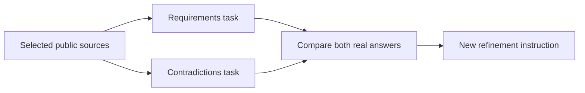
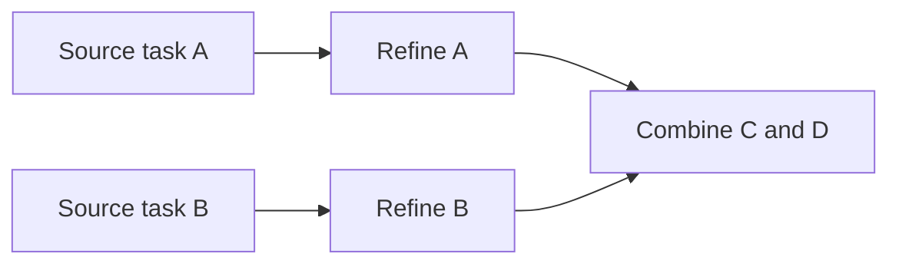

# Decentralized cooperative agents and automatic policy governance

This guide defines service contracts and recorded implementation limits. For current
priorities use [implementation status](../IMPLEMENTATION_STATUS.md); detailed superseded
trial sequences remain in the [service evidence archive](../archive/service-notes-20261026.txt).
Execution receipts do not establish answer quality, legal correctness or private-worker protection.

VOLPAROSSA's compute layer is intended to let agents on different devices **share tasks,
combine results and improve reusable models together**. Network collaboration is the target
architecture, not an optional collection of unrelated local chatbots. Participants contribute
within their available resources; the owner's own activity comes first.

This guide separates that design from executable development commands and recorded trials.
Public peer tasks and model-transfer milestones exist. **Reliable general reasoning, protected
private execution on other people's devices and complete automatic governance remain unfinished.**
Network/content checkpoints do not establish those compute capabilities.

## Studio editing and website maintenance

The [permanent Studio/hosting requirements](../development/GOAL.md#studio)
add bounded Silex editing and maintenance tasks to the existing shared model and
agent infrastructure. Reuse Core scheduling/resource control and Code's OpenCode
integration, with a scoped Silex MCP/tool adapter rather than a second AI network.
Editing, code/assets, review and publication have distinct permissions. Private
projects/customer data/credentials require protected processing or explicit waiting
or authorized local fallback; no arbitrary-peer disclosure or silent training.
AI/MCP/template output stays untrusted, and cannot authorize its own publication,
accounts, credentials or permission expansion. [The hosting acceptance plan](STUDIO_HOSTING.md)
requires a real shared Core task and independent review; local MCP connectivity
alone does not complete decentralized AI integration.

## How the pieces fit together

There are two connected activities:

1. **Doing work:** an authorized task supplies its input and scope; the coordinator selects
   compatible workers, sends permitted subtasks, collects their results and, where supported,
   combines them into an answer. A completed model response is not proof of a correct answer.
2. **Improving the workers:** eligible data is used to train a compatible model update.
   Evaluation checks the candidate before it can replace an accepted version. Sharing an
   update does not automatically authorize activation or prove that it is better.

The shared cache helps distribute permitted datasets, models and updates. It is a delivery
mechanism, not the definition of what the network may know or train on. Missing eligible
sources may need authorized retrieval outside the cache.

A few terms recur throughout this guide:

- **Network agent:** `volparossa-agent`, the unprivileged network supervisor—not an AI model.
- **AI worker:** the isolated process that performs model inference or a supported training job.
- **Model / adapter:** a model provides the base parameters; a compatible adapter carries a
  trained update. Arbitrary models and adapters cannot simply be combined.
- **Broker / coordinator:** a broker exposes an admitted worker slot; a coordinator manages
  an authorized task across workers. Neither grants unrestricted access to the device.
- **Immune system:** the intended mutual assessment, restriction and repair mechanisms.
  Its individual working pieces do not yet form the complete system.

### Reading paths

- **Understand the goal:** [requested outcome](#requested-outcome),
  [principle-led reasoning](#principles-guide-rules-not-the-other-way-around),
  [cache and data boundaries](#reuse-and-separation), and [resource sharing](#owner-first-resource-allocation).
- **Train and share models:** [training and model exchange](#training-and-model-exchange).
- **Run public work:** [peer jobs](#current-public-peer-job-candidate),
  [document tasks](#public-document-tasks), [cooperation](#cooperating-public-tasks),
  and [answer synthesis](#synthesizing-one-public-answer).
- **Understand privacy and governance:** [private tasks](#private-tasks-and-training-data),
  [policy decisions](#fully-automatic-whitelistblacklist-decisions), and
  [mutual checking](#mutual-checking-quarantine-and-repair).
- **Evaluate completion:** [B01–B07 requirements](#executable-sequence-and-completion-evidence)
  and the [implementation-status ledger](../IMPLEMENTATION_STATUS.md).

Command examples below are explicit development workflows. Their adjacent limits and evidence
apply to that workflow, not automatically to the whole compute layer.

## Requested outcome

The intended service has three responsibilities:

- **Assist users:** distribute suitable tasks and combine useful results across participating
  devices, rather than limiting every user to their own device's computing power.
- **Learn cooperatively:** train and exchange reusable artifacts, while evaluating whether
  each proposed successor actually improves the accepted model or workflow.
- **Maintain shared rules:** assess permitted/prohibited content and check, repair or exclude
  defective agents through the mutual governance system.

Participation remains capability-based. An idle device can contribute without training a
large model or retaining every model. No permanent central compute, training, task-dispatch
or decision authority is part of the target. Network-policy decisions are intended to be
fully automatic, without substituting a mandatory human approval step.

The user extended this scope on 2026-10-01 to autonomous maintenance of the core
and all current/future VOLPAROSSA organization repositories. Agents should share
implementation and independent review work under immune-system oversight, then
publish through narrowly authorized repository capabilities. This is not yet
implemented and does not distribute GitHub credentials to compute peers. The
user additionally approved automatic installation of authenticated releases on
VOLPAROSSA clients; this requires a separate verified update/activation facility,
not execution of arbitrary peer programs. See the separate
[repository-maintenance scope and publication boundaries](REPOSITORY_MAINTENANCE.md).

### Shared values

The requested positive principles are **Humilitas, Humanitas, Mansuetudo, Diligentia,
Liberalitas, Temperantia and Castitas**. The negative principles are **Superbia, Invidia,
Ira, Acedia, Avaritia, Gula and Luxuria**. These are the primary basis for agents' reasoning in
both applications: **concrete allowed/prohibited content decisions** for the whitelist/blacklist,
and **behavior and training** of agents themselves. The examples supplied on 2026-09-14 illustrate
intended applications; they are not an independent rulebook or the source of that reasoning.
Jurisdiction, assessment boundaries and conflict rules still need specification;
no numerical virtue score or automatic "good person/bad person" classification is implied.
Describing or critically discussing a vice is distinct from facilitating harmful conduct;
naming a principle is not yet a reproducible classifier or an implemented policy rule.

### Principles guide rules, not the other way around

The user clarified on 2026-09-21 that these Latin concepts were chosen as a higher-level ethical
framework, not as decorative labels for an exhaustive list of literal prohibitions. Enumerating
thousands of rules can leave gaps; literal compliance can also undermine the reason a rule
exists. The intended agent reasoning must consider purpose, context and consequences in new
situations, rather than treating an unlisted case or a verbal loophole as sufficient permission.

This applies both to agent behavior/training and to automatic whitelist/blacklist maintenance.
The required direction is **principles -> contextual reasoning -> decisions**. Concrete content
decisions are applications and recorded outcomes of the principles, not their complete definition.
Examples may illustrate and test the intended reasoning; matching a listed example is not the
decision procedure, and adding more examples is not a substitute for applying the framework to
unforeseen situations. Independent assessments should explain the relevant principles, the
observed evidence, competing interpretations and why a proposed decision serves their purpose;
mutual checking must test that reasoning, not merely count matching labels. Uncertainty and
conflicting interpretations remain explicit inputs to automatic reconsideration.

The framework does not grant agents permission to waive agreed legal or privacy constraints,
invent personal moral scores or silently replace the governing principles with their own. Nor does
an abstract vocabulary itself prevent deception, bias or conflicting judgments. Consistent
interpretation, evidence-bound decisions and correction remain implementation requirements;
this clarification changes the design description, not the active destination whitelist or the
completion status of the automatic governance system.

## Audio, images and natural conversation

Requested on 2026-10-04; **not implemented multimodal inference**. The current
compute contracts and admitted model profiles are text-oriented. Transporting,
caching or privately storing an image or recording does not mean that a model
can interpret it. The requested shared brain should understand images and spoken
audio, generate spoken responses and eventually support fluid, interruptible
voice conversations. Video understanding is a further extension with greater
processing and bandwidth demands; it is not supplied by image storage.

Implement this in useful stages: image interpretation and speech recognition,
then streamed speech generation and conversational coordination. Reuse suitable
open models and improve them through eligible training and measured evaluation;
do not require learning every capability from scratch. These capabilities belong
in the shared core, available to applications through versioned task contracts,
not in a separate local-only assistant for each application.

The core should place each task with compatible available workers, accounting
for model locality, latency, bandwidth, memory, compute and energy costs as well
as data protection. Reserve interactive capacity; throttle, pause or defer
background training and media processing when the owner's device needs its
resources. Bound admitted work, buffering and in-flight transfers, and cancel
obsolete speech generation when interrupted. Under insufficient capacity, make
delay or reduced service visible instead of exhausting peers or pretending that
a task succeeded. Resource budgets reduce interference; they cannot promise
zero latency, power use or contention.

Keep private media and derived transcripts/results private throughout network
execution. Existing public-worker operation does not establish confidential
remote media processing. Do not silently enable microphones/cameras or turn
recordings, faces, voices or conversations into shared training data. Reuse
public or otherwise authorized material and suitable privacy-preserving learning
mechanisms. Immune-system review must not expose private media to arbitrary
reviewers. A natural-sounding synthetic voice should remain recognizable as AI
interaction, not a claim that a human is speaking.

Evaluate comprehension, transcription, voice intelligibility, interruption,
end-to-end latency and resource cost against stable reference tasks. More peers
can supply capacity and more eligible learning opportunities; neither more peers
nor additional training alone proves better understanding or a human-quality
conversation. This section records the requested direction, not a completed
worker, training loop or real-time speech datapath.

## Agreed content-policy examples

These historical examples preserve the user's intended outcomes and distinctions. They illustrate
reasoning from the seven virtues/vices; they are not foundational rules, an exhaustive taxonomy
or a template that substitutes example-matching for assessment. They do not activate destination
rules. The legal and privacy constraints remain independently applicable.

### Prohibited conduct and material

Examples include illegal content/conduct, unauthorized piracy, scams/fraud and child sexual
abuse material (CSAM). Refuse prohibited material and tasks facilitating that conduct.
Lawful reporting, prevention, victim support, legal education and critical discussion are
not the conduct itself; this does not authorize distributing illegal source material as
"research".

### Context-dependent cases

No blanket verdict has been agreed for lawful adult pornography, gambling, harmful
compulsive/low-value social-media use or radicalizing forums/chat groups. Assessment must
distinguish legal consensual adult material from exploitation, licensed lawful activity
from prohibited activity, and ordinary discussion from incitement, threats or recruitment
to violence. A platform name, unpopular opinion or political/religious identity is not
enough evidence.

### Allowed behavior with optional advice

Lawful shopping/overconsumption, including Amazon, and ordinary viewing/posting on X/Twitter,
Reddit and Facebook remain allowed. Do not turn "unnecessary," environmentally undesirable
or unwise spending into an automatic ban. Constructive advice must be transparent and
dismissible—not covert throttling, forced redirection or public profiling of users.

### Boundaries that apply to every assessment

An assessment must distinguish the **content or requested action** from a **pattern of use**.
A short video is not inherently evidence of harmful compulsive use. Personalized wellbeing
suggestions require an explicit local feature; they must not introduce default browsing-history
retention, cross-node behavior dossiers or a model inferring moral worth from private activity.
Agents should derive and explain these distinctions from the principles, rather than using the
examples as their foundation; the principles do not grant authority to punish disagreement.

"Outside the law" needs an applicable, versioned legal basis, not whichever country's law a
peer happens to assert. EU and national laws can differ, as the
[European Commission explains](https://digital-strategy.ec.europa.eu/en/factpages/tackling-illegal-content-online-digital-services-act).
The user selected **Netherlands/EU as the common network baseline, plus applicable local exit
restrictions** on 2026-09-14. A local restriction must not expand the common network allowance;
an exit enforces the intersection, not whichever rule is more permissive. This choice is a
design requirement, not implemented jurisdiction discovery or a legal determination for a node.
The future decision records must distinguish a legal prohibition
from a separate network-community rule and identify their authority and scope. This document
does not determine intermediary status, applicable liability or jurisdiction for each node.

Whitelist/blacklist decisions cannot promise a perfectly "clean" cache or eliminate exit risk.
Original signatures and content hashes establish provenance/integrity, not legality, consent or
redistribution rights. An approved hostname does not approve every object behind it. Public
chunk admission therefore needs a decision bound to the original object's identity/version;
an unknown object or unsigned peer accusation is not a valid approved/forbidden decision.
Revocation must stop new serving/redistribution of the affected local object without allowing a
remote model to delete unrelated files. Existing copies on uncooperative peers cannot be
guaranteed erased.

The engine must not break end-to-end encryption or expose private prompts/messages to public
assessors to manufacture a universal filtering claim. How untrusted encrypted publications are
admitted without becoming an unchecked shared-storage channel remains a required design and
implementation problem. Cache custody currently verifies bytes and publication provenance;
it **does not implement** the requested moral/legal content classification. Use synthetic,
non-actionable fixtures and authorized benign corpora for development; never obtain real CSAM
or illegally redistribute copyrighted works to build the classifier's tests/training set.

The separate [private-storage immune system](PRIVATE_STORAGE.md#storage-immune-system-and-private-content-limits)
must also address prohibited-content admission and storage abuse. Public-object judgments
are not private-backup deletion authority. Ciphertext integrity checks, quotas and uploader
self-attestation do not establish the legality of encrypted files; this privacy-preserving
admission and response mechanism remains unfinished.

## Reuse and separation

The user explicitly confirmed on 2026-09-14 that autonomous training should exploit the
existing distributed cache. This is a **required integration**, not an automatic property of
the current cache or of local adapter training. Cache model weights, compatible adapters,
eligible training packages and evaluations once, then prefer work on nodes already holding
the required chunks. Otherwise retrieve only the missing chunks through the protected content
datapath; use the same spare-capacity sharing budget as ordinary cache traffic.

Eligibility for serving an object is not permission to train on it. An automatic training
job needs an explicit dataset identity, origin, redistribution/training rights, privacy class
and compatible model revision; arbitrary cached browsing content, private messages or peer
instructions are not default training inputs. Dataset selection, deduplication and diverse
sampling must avoid rewarding peers for flooding the cache with copies of one source.
Validate candidate updates against held-out data before activation, with bounded rollback or
quarantine; signature/hash checks alone do not detect poisoned or low-quality models.

The user additionally required on 2026-09-14 that the cache must **not define the available
knowledge or training corpus**. Select eligible sources/examples for relevance, provenance,
coverage and diversity before deciding how to acquire them. Prefer existing verified chunks
when advantageous, but fetch missing/fresh chunks from other holders or the original approved
publisher/origin. A cache miss is not a reason to silently substitute a more popular cached
source. Preserve original authority, expiry, access rights, privacy and contribution budgets
on fallback; do not invent arbitrary Internet egress or unlimited background crawling.
Ordinary cache-only mode is an explicit offline/resource choice, not the autonomous-training
default. A future selector must measure coverage and sample less-represented eligible sources;
cache locality may influence execution placement, not whether a relevant source is considered.
Origin fallback alone does not prove freedom from selection bias. This selector and generalized
external-dataset ingestion are still required work, not implemented by the initial adapter codec.

### Autonomous Internet use

On 2026-10-04 the user explicitly authorized autonomous Internet use for user
tasks, research, improvement, maintenance and learning. It is a normal shared
core capability, not limited to explicit search questions or cache misses. Agents
should be able to select relevant permitted external sources and obtain missing
or newer information without requiring approval for each read within the granted
scope. Internet access is a source/tool capability, not unrestricted worker
network access or authority to change the network's exit policy.

Source acquisition belongs in the core's mediated tool path: preserve the
protected route and destination policy, access rights, provenance, freshness,
size/time budgets and cancellation. Prefer eligible cached content when useful,
deduplicate shared retrieval and respect source rate limits; do not evade limits
by spreading requests over participants. Foreground work takes priority over
background research and training. Selecting a source for reading does not grant
redistribution or training rights. Private task context, credentials and records
must not be included in searches or uploads merely because Internet access is
available.

Treat pages, retrieved code and documents as untrusted data, not instructions
that can change the task, grant permissions or trigger software installation.
External changes, account actions, publication and releases continue to use
their separately scoped capabilities. The shared immune system assesses source
and result quality without substituting for access controls or granting agents
authority to approve their own changes.

Existing selected-source collection and protected content retrieval are useful
building blocks. General autonomous web research, source discovery and external
training-corpus ingestion remain unfinished; this authorization does not claim
that the current network-isolated model workers can browse the Internet.

### Shared artifacts and execution boundaries

- Reuse content-addressed chunks, original signed manifests, protected peer retrieval and
  custody for public model weights, compatible updates and evaluation artifacts. Caching an
  artifact must not activate it. A signature proves provenance, not model correctness.
- Separate a model's data from its runtime and tools. Use an explicitly supported, versioned
  model/operator format in an isolated worker; do not execute downloaded scripts, plugins,
  pickle objects or native libraries. Model/artifact distribution does not grant
  executable-update authority. The separately approved client updater must verify
  release authority and exact artifacts before activation.
- Discover short-lived compute capabilities through the existing peer model, not a central
  worker catalogue. Input/output sizes, task lifetime, hardware needs and privacy requirements
  are part of the job contract; public indexes contain neither prompts nor private documents.
- Use compatible model families and bounded local updates. Arbitrary agents or weights cannot
  simply be averaged into a single model. The shared "brain" is coordinated training and task
  execution, not a claim that all users' private memories become globally shared state.
- The network supervisor `volparossa-agent` remains separate from these AI workers. Workers
  receive no helper privileges, node signing keys, home directory, browsing history or arbitrary
  tool authority. External task effects require narrowly scoped user-authorized capabilities;
  another agent's output cannot grant them.

## Training and model exchange

This reference follows the model lifecycle: provision a pinned backend, produce a compatible
update, distribute it through the cache, evaluate successors and, for explicitly enrolled
work, use an accepted successor. The sections retain the command limits and source-bound
results for each step. A later step does not retroactively qualify every earlier experiment.

### Initial executable backend (development candidate)

The user approved an existing open model as a starting point: SmolLM2-135M-Instruct at
revision `83212e1e2b3cfd6958f3707877bb878945dea8ee` (Apache-2.0). The explicit guest-only
provisioner in `workers/volparossa-ml/` verifies every model asset and all 38 CPU Python
wheels against exact sizes/SHA-256 pins. It preserves original license/model-card bytes and
does not install on the development host or fetch dependencies at worker runtime.

An explicit second profile, `smollm2-360m-v1`, pins SmolLM2-360M-Instruct at
`a10cc1512eabd3dde888204e902eca88bddb4951`. It supports inference, source tokenization and
task planning, not training or the incompatible 135M adapters. It uses the same pinned CPU
runtime and isolation; see [asset and license provenance](../../THIRD_PARTY_LICENSES.md).

| Explicit profile | Ordinary prompt | Generated answer | Escaped answer bytes | Rows per worker |
| --- | ---: | ---: | ---: | ---: |
| `smollm2-135m-v1` (default) | 192 tokens | 64 tokens | 1,024 | 4 |
| `smollm2-360m-v1` | 1,024 tokens | 256 tokens | 4,096 | 1 |
| `smollm2-1.7b-v1` (optional candidate) | 1,024 tokens | 256 tokens | 4,096 | 1 |

The optional 1.7B profile pins `HuggingFaceTB/SmolLM2-1.7B-Instruct` at
`31b70e2e869a7173562077fd711b654946d38674`. Its existing CPU backend explicitly loads
BF16 parameters; the worker checks and reports the actual loaded dtype. There is no silent
FP32 fallback, automatic installation, training or compatible 135M adapter for this profile.
The original 135M and 360M profiles retain their existing FP32 execution and model identities.

Select the same `--model-profile` when explicitly provisioning the model, starting its
`compute serve` broker, and enrolling a new `compute peer document` task. `compute run`
also accepts it. Discovery filters for the chosen base profile; manual enrollment checks the
actual peers and pins their common complete model fingerprint before tokenization or publication.
Resume uses the original profile and fingerprint, not a newly supplied CLI choice. Signed
packages may still contain four rows, but the ready queue dispatches singleton 360M/1.7B jobs.
Legacy batch-barrier enrollment is not supported for these profiles.

Synthesis retains complete parent text and the matching profile rather than silently applying
135M limits. A token-limited or wire-truncated output cannot become a completed answer or new
dependency. The task-question planner keeps its separate 512-prompt / 384-total-generated-token
budget and four-attempt limit; selecting a model does not enlarge that planner budget, the
600-second worker deadline or two-thread bound. The 135M/360M profiles keep their 3-GiB sampled
RSS cancellation and 6-GiB address-space limits. Selecting 1.7B explicitly selects a 5-GiB
sampled RSS limit and 10-GiB address-space limit. Before launch and when advertising availability,
it requires at least 5.5 GiB of observed spare memory, using the minimum of host availability
and observed cgroup parent limits. This is admission, not a memory reservation; existing
pressure cancellation and owner-priority controls still apply. RSS sampling is not a hard
cgroup cap or a guarantee that a user never notices load.
<details>
<summary>Recorded model-execution trials and their reasoning limits</summary>

Recorded 360M/1.7B trials demonstrate bounded execution, not generally useful reasoning.
The [1.7B runtime pass](https://github.com/VOLPAROSSA/volparossa/actions/runs/35883858055)
verifies its original raw 10-GiB soft/hard limit, isolation and cleanup but retains
incorrect privacy reasoning; earlier failed observers remain failed. Detailed
resource measurements and original answers remain in the service evidence archive.

</details>

#### Answer instructions and isolation

New public answers and source-grounded synthesis now use the explicit
`public-source-parts-v1` instruction: address every requested part, treat supplied text as
untrusted data, distinguish supported conclusions from missing evidence, and avoid repetition.
Document planning counts this same complete prompt. Optimizer/heldout-loss prompts, private
and principle-assessment prompts, and historical source-free synthesis remain unchanged;
completed jobs retain their original reports on resume. The revision appears in new worker
reports, but it is not part of the model-weight fingerprint and is not proof of answer quality.

`volparossa compute run` is preview-only unless `--execute` is supplied. The current CLI
supervises one real Python CPU worker in mandatory Bubblewrap network/PID/IPC/mount
isolation, exposing only the installed runtime, selected public dataset, pinned model and
new private output. The fixed worker performs inference or rank-4 LoRA training, compares
actual base/adapter tensors, saves safetensors, loads a fresh base plus saved adapter and
evaluates again. Rust enforces the wall-clock deadline, bounded protocol, resource-pressure
cancellation and external artifact hashes. There is no unsandboxed fallback, private-input
training, automatic cache training or automatic policy activation yet. Explicit public peer
job execution has the separate source-bound checkpoint below.

The initial resource boundary includes two CPU threads maximum, idle CPU/IO priority,
per-process address-space/CPU-time/file-size limits, bounded scratch space, sampled aggregate
RSS/output cancellation and an owner-cancellation input. Sampled RSS is **not** a hard cgroup
memory cap, and this foreground CLI does not detect all interactive activity or guarantee
physical-device safety. Actual model execution and sandbox observations now pass the source-bound
distinct-node smoke below: eight CPU optimizer updates change 230,400 LoRA parameters,
the original base remains unchanged, and a fresh base/adapter reload is evaluated.
B01 still needs broader interactive/physical-device evidence; real CPU-pressure pause/resume now
passes below. Improved answer quality, distributed
training and the full brain remain separate work. A small development model is not sufficient evidence for reliable
legal or content-policy judgments.

#### Yielding to the owner's activity

Owner-priority control adds `--spare-capacity` to `compute run` and `compute train-cycle`;
`compute serve` uses the same mechanism by default. Fixed, sequenced private-pipe commands
pause and resume at model/optimizer checkpoints, with acknowledgements from the execution
thread. CPU `some avg10 >= 20` or I/O `some avg10 >= 10` pauses; five seconds of continuously
sampled quiet permits resumption. Unknown pressure cannot authorize work; unknown or less than
512 MiB available memory across the host and unified-cgroup parent limits cancels and reaps it.
Existing RSS/output limits and the original wall-clock deadline continue while paused. The
broker advertises no free slot under observed pressure. These are coarse capacity observations,
not universal owner-activity detection or a hard cgroup reservation. Native operations are not
preempted mid-call; unacknowledged commands have a bounded timeout. Standard-library worker
process/pipe and focused Rust tests pass. The [actual owner-priority run](https://github.com/VOLPAROSSA/volparossa/actions/runs/34876248467)
passes on exact source `d12768e31c0351e15416f05a8b986905367cab66`, including raw verification:
eight disposable-guest contenders produce CPU pressure; the same model worker acknowledges
pause/resume at step zero, uses zero CPU ticks in a measured 1.607-second paused interval,
then finishes eight updates within its original deadline. Total acknowledged pause is 8.599
seconds. All contenders/worker are reaped, temporary roots are removed and original guest-root
hashes match. This measures CPU-pressure handling, not all owner activity, owner-triggered
cancellation, battery/thermal behavior or the entire B01 criterion. Exact artifact/checker/hash
details are retained in [implementation status](../IMPLEMENTATION_STATUS.md).

#### Battery, temperature and cancellation

The device-priority candidate additionally reads exposed Linux system-battery and thermal
sysfs data, caching observations for at most one second. Battery charge at or below 20%
pauses ML work; at or below 5% cancels it, including while charging/on AC. Thermal zones pause
at 80°C and cancel at 90°C, or earlier when a lower passive/hot/critical trip minus a 5°C
margin applies. The [Linux inactive-trip placeholder](https://github.com/torvalds/linux/blob/v6.12/drivers/thermal/thermal_core.c)
is ignored as a limit, not treated as a temperature measurement; the software 80°C/90°C limits still apply. Malformed
or unreadable temperatures/trips remain unknown. Present but invalid observations pause work; `not_exposed` is
explicitly reported and does not prove absent hardware or safe temperatures. Critical observed
reserves still cancel when another observation is unknown. The train-loop's worker admission,
peer executors and explicitly enabled `--spare-capacity` jobs use this budget; seed imports
and update publication are not controlled by this ML device-budget gate.
`volparossa compute capacity` reads the same observations without changing device settings,
running a model or contacting the network. It is an admission hint, not a reservation or a
logind/interactive-activity detector. All 68 focused CLI compute tests and strict CLI Clippy
pass; physical battery/thermal behavior is not yet demonstrated.

The `agent-owner-cancel` fixture requires owner-UID pidfd-targeted SIGINT,
`compute_owner_busy`, CLI/descendant reaping within five seconds, unchanged base,
released runtime lock and cleanup. [Run 34893645697](https://github.com/VOLPAROSSA/volparossa/actions/runs/34893645697)
passes that bounded scenario, not a universal cancellation-latency guarantee or full B01.

### Cache-backed adapter candidate

The next implementation connects the worker to ordinary signed native content:

1. Publish the explicit public training JSON with content type
   `application/vnd.volparossa.agent-dataset.v1+json` using `content publish`.
2. `content agent pack --directory JOB/adapter --training-report JOB/report.json
   --dataset-manifest DATASET.manifest --publisher-key KEY --output ADAPTER.bundle`
   binds the exact three files and the job's dataset hash to the verified dataset manifest.
   Publish the resulting bundle as `application/vnd.volparossa.adapter.v1`.
3. `content agent fetch --publisher-key KEY --name ADAPTER_NAME --dataset-name DATASET_NAME
   --cache AGENT_CACHE --output NEW_PRIVATE_DIRECTORY` retrieves both objects through the
   existing protected peer path, verifies their original publisher and exact dataset link,
   and exports `adapter/`, `dataset.json` and `provenance.json`. Both publications must have
   the explicitly trusted publisher. A changed dataset revision is refused, not silently
   substituted for the one used to train the adapter.
4. An explicit `compute run --adapter-root .../adapter --dataset .../dataset.json` can use
   that adapter for inference or continued training. The fixed worker checks all 120 FP32
   tensors, exact shapes, finite values, fixed LoRA configuration and base identity before
   applying them. Peer-provided JSON never supplies runtime classes, scripts or operators.

All paths above are examples; supply absolute paths/private output parents and the normal
compute runtime/model/output arguments. `--execute` is required for computation; fetching
does not activate an adapter. `--cache-only --reuse-cache` is an explicit offline option,
not the default.
[Run 34861750881](https://github.com/VOLPAROSSA/volparossa/actions/runs/34861750881)
completes B02's explicit trained-adapter transfer/reuse with a pre-provisioned common
base/runtime. It does not prove base-model distribution, automatic activation,
external-corpus ingestion, bias-aware source selection or improved answers.

### Explicit cache-backed training cycle

`compute train-cycle --publisher-key KEY --dataset-name NAME --dataset-manifest-id SHA256
--cache AGENT_CACHE --reuse-cache --runtime-root VENV --model-root MODEL
--adapter-root IMPORTED/adapter --output NEW_PRIVATE_CYCLE --steps 8 --execute`
joins source retrieval, actual local training and adapter packaging without separate manual
file-copy steps. Use absolute paths and pre-provisioned runtime/model directories; the adapter
and exact manifest pin are optional. Without `--execute`, it only prints the selected plan.

The operator chooses the publisher and dataset name before cache lookup. The optional exact
manifest pin, revision floor, fixed dataset type and 1-MiB object bound are checked by the agent
before peer-body retrieval, and again by the consuming CLI. An explicitly preferred complete,
unexpired cache object needs no route or provider; a miss retains the same publisher/name and
uses the normal protected retrieval path. This is not a globally newest-version claim, an
arbitrary-origin download, or permission to substitute another popular cached source. Source
signatures establish provenance, not legal/training-rights or model-quality guarantees.

The cycle records its selection before fetching and retains the original signed dataset,
source receipt, supervised training report and `adapter.bundle` in a new private directory.
An optional previously imported adapter is used as the actual warmstart; it is not silently
selected from cache. Training uses the existing isolated fixed worker, at most two CPU threads,
1–64 optimizer steps and at most 600 seconds, further bounded by source expiry. Interruption
cancels and awaits worker cleanup; incomplete files are retained rather than reported complete.
Publish the bundle separately with the normal content command. There is no automatic adapter
activation, source discovery, retraining loop, distributed gradient aggregation or policy change.
[Run 34876251732](https://github.com/VOLPAROSSA/volparossa/actions/runs/34876251732)
proves one explicitly chosen cache-backed warmstart cycle, with protected retrieval,
read-only received adapter, unchanged base and cleanup. Autonomous discovery/training,
defended aggregation and full B05 remain open.

### Continuous public training candidate

`compute train-loop` connects the existing real cycle executor to an owner-enabled persistent
coordinator. The plan is a version-1 JSON object with a `sources` array; each entry contains
`publisher_key`, `name`, and optionally `min_revision` and an exact `manifest_id`. These are
explicitly eligible public sources, not browsing history or a scan of whatever is cached.
Round-robin selection and retry timing operate on that plan before cache lookup. Missing bytes
are requested for the same selected source; this avoids cache availability deciding the corpus,
but does not claim representative, unbiased or automatically discovered training data.

```sh
volparossa compute train-loop --plan /OWNER/public-sources.json \
  --directory /OWNER/training-loop --cache /AGENT/existing-cache \
  --runtime-root /OWNER/existing-runtime --model-root /OWNER/existing-model \
  --steps 8 --execute
```

These are illustrative absolute paths: the private parent, pinned runtime/model and native
agent cache must already exist. Nothing is installed or downloaded as executable code by this
command. Without `--execute`, it only previews enrollment. Omit `--max-cycles` to keep watching
until SIGINT/SIGTERM; that option limits new attempts in this invocation, not lifetime progress.
`--resume` reopens the exact enrolled directory and continues from durable state. Subsequent
cycles warmstart from the last completed local adapter. By default, a source must provide a
newer revision after success; `--repeat-sources` explicitly permits training on unchanged data.

An optional `--seed FILE` selects an initial protected peer import by `publisher_key`,
`dataset_publisher_key`, `name`, `dataset_name`, and optional adapter `min_revision`. The two
publisher keys are independently trusted; the dataset must match the exact original identity
inside the adapter bundle. Alternatively, `--adapter-root` selects an existing local adapter.
The coordinator cannot silently replace either source with an arbitrary peer's model.

Automatic sharing is separately enabled with `--publish-name`, `--publication-key`, the existing
encrypted `--identity`, private `--passphrase-file`, and an existing owner `--publish-cache`.
Each completed bundle is signed once, never beyond its dataset's original expiry. Failed
handoffs retry that exact manifest through `content contribute`; they do not re-sign it or
renew its lease. Completed transfer receipts can be reconciled after a restart. This contributes
the adapter, not automatically its source dataset: a receiver still needs the independently
trusted dataset available from an authorized provider. CLI `content agent fetch` also
accepts `--dataset-publisher-key` for this case; omission preserves same-publisher behavior.

After reaching `--max-cycles`, the coordinator makes no new training attempts but gives its
already approved pending publications one final retry window of `--max-seconds`. All network
handoffs share that single monotone deadline and retain their earlier original source/manifest
expiry; the deadline is not restarted per item. Local preparation and durable identity writes
finish before a handoff can be interrupted. The final `publication_drain` value distinguishes
completion, cancellation, deadline and expiry; retained expired publications are not labelled
successfully shared. A timed-out publication stays pending for explicit later resume. This
does not enlarge any worker lease or authorize more training.

The overall watcher has no preset end time, but runs one bounded, spare-capacity worker at a
time. Existing source expiry, CPU/thread, memory, per-worker deadline and cache limits remain.
It retains at most eight cycle directories; the current warmstart and pending publications
are never pruned to make room, so a full pending queue pauses further training. Interrupted
workers are not marked complete. An initial peer import interrupted between atomic output
publication and its state checkpoint is retained and refused on resume, not silently trusted.

[Train-loop run 34887897332](https://github.com/VOLPAROSSA/volparossa/actions/runs/34887897332)
passes two real bounded cycles, automatic contribution, another Client's protected
import/inference and cleanup. It establishes neither general planning/model quality,
private training, defended aggregation nor full B05.

### Source-heldout successor selection

New train-loop enrollment fixes `quality_policy: source-heldout-loss-v1`. A technically complete
training cycle is now a candidate, not automatically the next warmstart. The worker already
measures token-weighted held-out loss after applying the predecessor and before training,
then after training and after a fresh checkpoint reload. Only a finite reloaded-candidate loss
strictly below the predecessor loss minus `1e-6`, with matching positive target-token counts
and reload consistency, approves promotion and optional automatic publication.

Each cycle retains `evaluation.json` with exact source, report, predecessor and adapter
bindings. Recovery and publication recheck that decision against the immutable cycle snapshot.
Rejected candidates keep their real output, do not replace the previous warmstart and are
eligible for bounded local cleanup. Source revision tracking still advances after a measured
rejection, so the same revision is not silently trained forever. The loop reports technical
completions, promotions and rejections separately.

This changes coordinator state to version 2 and adds the enrolled policy. Existing version-1
loop directories are not silently migrated or relabelled: keep their results, and start a new
directory with an explicitly selected compatible adapter if further training is wanted.
The current source supplies both training and held-out examples; within-source disjointness
does not establish an independently selected benchmark or exclude cross-round contamination.
This is a scoped measured promotion rule, not evidence of general intelligence, no forgetting,
globally monotone improvement or robust peer evaluation. Independent evaluation/selection and
specialist retention remain required work.
[Run 34896078997](https://github.com/VOLPAROSSA/volparossa/actions/runs/34896078997)
passes the small same-source promotion proof; neither candidate exercised rejection.

### Explicit second-source validation candidate

Add `--validation-source /absolute/path/validation-source.json` to a new loop's normal command.
This private JSON has the same `publisher_key`, `name`, optional `min_revision` and
`manifest_id` fields as a source-plan row, but **requires an exact manifest ID**. Select it
independently of cache availability, with a different publisher/name pair from every training
source. It must be a signed public v1 dataset with `train: []`, 1–8 held-out rows and 1–4
inference rows. The runtime verifies its signature and bytes, uses the cache when available,
and retrieves that exact source over protected routes on a miss. It never substitutes a
more convenient cached dataset.

Enrollment fixes `source-and-second-source-loss-v1` and pins the retrieved source before any
loop training. Every newly fetched training source is checked for normalized-question overlap
with the validation rows before model work. Each completed training cycle then runs two
sequential, isolated `infer` jobs: the retained predecessor (or initial adapter/base) and the
new candidate, on identical second-source bytes, without gradient updates. Promotion requires
the original source-heldout gate **and** second-source loss improvement greater than `1e-6`.
Both jobs retain the ordinary owner priority, resource limits and source-expiry deadlines.

The `evaluating` phase saves the finished training checkpoint before comparison. Validated
completed inference stages and their original deadlines are reused on resume without training
the candidate again. A partial inference output lacking its supervisor's durable result is
retained as an explicit interrupted-stage error, not silently accepted or overwritten. Completed
cycle snapshots bind all source files, both actual reports and the final decision. Rejection
still preserves the previous approved adapter and remains eligible for bounded reclamation.

Repeatedly selecting on this set makes it a validation/selection set, not a fresh independent
test benchmark. Question matching does not detect semantic overlap or prove that a pretrained
base/imported seed never saw the content. It does not establish general intelligence or global
quality improvement.
[Corrected run 34901453523](https://github.com/VOLPAROSSA/volparossa/actions/runs/34901453523)
passes second-source execution/adoption and cleanup. Its twelve-target-token losses
improve while all generated answers remain identical; rejection and independently
selected benchmark quality are unproved. The earlier workflow remains failed.

### Signed public source catalogs

The new version-2 training plan can enroll **catalog publishers**, without enumerating each
dataset locally. The same ongoing loop discovers newly listed datasets and newer revisions,
then uses its existing protected fetch, actual training, evaluation and optional signed sharing.
Enrollment remains explicit; there is no mandatory central catalog or authority inferred from
cache popularity. Multiple independently chosen publisher catalogs can be used.

For example, replace the key below with an independently trusted publisher's Ed25519 public key:

```json
{
  "version": 2,
  "sources": [],
  "catalogs": [
    {"publisher_key": "<64 lowercase hexadecimal characters>", "name": "public-training-sources"}
  ]
}
```

Use this file with the normal `compute train-loop --plan ... --execute` command above.
Version-1 fixed-source plans keep their existing behavior. Catalog entries also accept an
optional `min_revision` and exact `manifest_id`; pinning an exact catalog ID deliberately
prevents following a replacement. Nothing starts in preview mode.

The publisher signs an ordinary native public file with content type
`application/vnd.volparossa.agent-source-catalog.v1+json`, using the existing `content publish`
and contribution service. Its JSON body has this profile:

```json
{
  "version": 1,
  "visibility": "public",
  "purpose": "agent_training",
  "dataset_profile": "application/vnd.volparossa.agent-dataset.v1+json",
  "license": "GPL-3.0-only",
  "sources": [
    {"name": "public-dataset-a", "revision": 1, "manifest_id": "<exact dataset manifest ID>"}
  ]
}
```

Every listed dataset must be signed by that same enrolled publisher; a catalog cannot silently
delegate trust to another key. Names, positive revisions and exact manifest IDs are bound to the
original signed catalog. Actual datasets still require the supported public training profile
and independent verification before model work. A publisher's license/permission assertion is
not proof of legality, accuracy or quality, and arbitrary cached documents are not admitted.

Each refresh asks for current name metadata without allowing an older cache hit to suppress the
lookup. Unchanged valid publications remain acceptable. Rollbacks and equal-revision conflicts
are rejected; this is observed-revision protection, not a globally newest-version guarantee.
Dataset retrieval remains exact-ID and cache-first, with protected retrieval of missing data.

The registry retains stable source positions and completed revision floors across refreshes and
restart. Reordering a catalog cannot reassign old cycle receipts; a rejected but completed update
does not silently retrain. Withdrawal or original expiry stops new admissions without deleting
past results. A failed refresh can use the previous signed snapshot only until its original
expiry. The per-cycle checkpoint retains the original catalog and selected row; the worker's
deadline also respects that catalog's expiry. The separate validation source remains excluded.

This first working cohort allows at most 16 catalogs and 128 remembered source identities in
total, including fixed sources. A full registry reports capacity refusal instead of discarding
history and accidentally repeating old work. It supports ongoing revisions, not an unlimited
stream of new source names. Source selection remains round-robin, not a learned relevance or
coverage model.
The recorded [catalog trial 34903399004](https://github.com/VOLPAROSSA/volparossa/actions/runs/34903399004)
performs real training/validation, cold dataset discovery and zero-attempt restart,
but fails the later independent import with `CONTENT_UNAVAILABLE`. It is not full
external ingestion, defended aggregation or completed B05.

### Learning from peer updates

The new optional `--peer-updates /absolute/path/peer-channels.json` lets an ongoing local
training loop consider compatible adapters published by explicitly chosen peers. It requires
the independently pinned `--validation-source` described above. The channel file is owner-private
JSON, for example:

```json
{
  "version": 1,
  "channels": [
    {"publisher_key": "<64 lowercase hexadecimal characters>", "name": "public-agent-updates", "min_revision": 1}
  ]
}
```

The coordinator discovers a signed adapter revision through the existing protected content
plane. Its bundled dataset ID must resolve to exactly one **independently selected** training
source, either a fixed plan entry or a currently eligible enrolled catalog entry, with exact
manifest ID and revision. An unknown dataset stays pending; the adapter publisher cannot add
new dataset authorities merely by referencing them. Missing authorized bytes remain fetchable
from peers rather than being replaced with something convenient in the cache.

Import retains the original signed adapter and dataset, exact extracted files and retrieval
receipts. The local worker then runs two isolated, zero-update inference jobs on the same pinned
validation bytes: the actual current adapter/base and the candidate. Adoption requires equal
target counts and a loss reduction greater than `1e-6`; a publisher's quality claim is not used.
Declared training/validation question overlap is rejected before comparison. The usual owner
priority, resource bounds, cancellation and original source-expiry limits still apply.

A successful peer comparison changes the selected warmstart, **not** the local completed-cycle
counter. The next real local training job applies those exact imported weights. Its checkpoint
binds the foreign publication, comparison and input-file identities separately from any previous
local cycle. A new local successor must still pass both ordinary promotion gates before it can
replace that warmstart and be shared under the local publisher's identity. Rejected local work
does not silently replace the accepted peer adapter.

One candidate is processed at a time, with at most 16 enrolled channels and eight retained peer
rounds. Retention preserves the active imported weights and only reclaims the coordinator's
recognized inactive files. Completed comparisons and original identities are checked on reopen;
finished work is not counted as fresh training. These are explicit development resource bounds,
not a claim that the whole network must contain only 16 peers or eight agents.

[Peer-update run 34914384494](https://github.com/VOLPAROSSA/volparossa/actions/runs/34914384494)
passes compatible import, comparison/adoption, continued training, validated
republication and independent Client inference with unchanged product authorization.
Earlier publication/fixture failures remain failed. This is compatible-adapter reuse,
not weight merging, private offload, poisoning resistance, general planning or
validated general quality/diversity from a small reused validation set.

### Combining three public adapter contributions

`compute aggregate-adapters` implements an explicit, bounded next step beyond choosing one
peer's adapter. Its owner-selected plan names one exact signed training dataset and three
different trusted adapter publisher keys. Each original bundle and its dataset are fetched
through the existing protected/cache path and verified independently; cache absence does not
select a different source. Three keys do not prove three independent or honest parties.

The fixed 135M worker combines **effective LoRA weight deltas**, not the A/B factors directly:
per module it takes the coordinate-wise median of three `2 × B × A` deltas in FP64, projects
the result to rank four with SVD, and saves finite FP32 factors. It records original input
hashes and both rank-truncation and stored-output residuals. This is aggregation with **zero
optimizer updates**, not a fabricated training run. Owner priority, read-only inputs, the
existing two-thread resource limit and original worker deadlines remain in force.

A separate, owner-pinned validation-only source then drives actual baseline and candidate
inference. The candidate must improve the measured loss before a local `adapter.bundle` is
created. No serving state, publication, whitelist or training-loop counter changes. Original
inputs, signatures, selection, worker report and comparison remain in the new private directory;
failure never reuses or overwrites an old attempt. This first version requires the same exact
training dataset ID for all inputs, not mixed-source or private-data aggregation.

The plan is JSON version 1 with `dataset: {publisher_key, name, revision, manifest_id}` and
exactly three `adapters: [{publisher_key, name, min_revision}, ...]` entries. Publisher keys and
manifest IDs are explicit lowercase hex. The validation selection uses the existing train-loop
Source JSON format with an exact `manifest_id`.

```sh
volparossa --control-socket /OWNER/agent.sock compute aggregate-adapters \
  --plan /OWNER/three-publishers.json --directory /OWNER/new-combination \
  --runtime-root /OWNER/existing-runtime --model-root /OWNER/existing-model \
  --cache /OWNER/existing-agent-cache --validation-source /OWNER/validation-source.json
```

Without `--execute` this only previews the plan. Optional `--adapter-root` selects the current
local baseline instead of the pinned base model. Compilation and inert admission/dispatch
checks pass; the first real three-publisher result and its reporting failure are described below.
Neither the median nor one validation set establishes poisoning resistance, general intelligence
gain or completed B05. Owner-enrolled automatic training-loop integration is described below.

An approved result can now be shared explicitly using `compute publish-aggregate`:

```sh
volparossa --control-socket /OWNER/agent.sock compute publish-aggregate \
  --directory /OWNER/new-combination --publish-name combined-public-adapter --revision 1 \
  --publication-key "$OWNER_PUBLIC_KEY_HEX" --identity /OWNER/identity.key \
  --passphrase-file /OWNER/identity-passphrase --publish-cache /OWNER/existing-public-cache
```

The default is a read-only recheck/preview. Add `--execute` to sign and contribute through an
already authorized content-serving agent. All three original signatures, exact cohort bytes,
validation and approval are reopened before handoff. Publication expires no later than the
earliest original authority; retries reuse the same signed manifest, not a new training cycle
or a renewed lease. The local publication directory retains the original request, manifest and
receipt. This is a publisher signature on an aggregate, not an attestation that its contributors
are independent or honest. No model or policy is activated by publishing it.

Other nodes can use the existing adapter fetch and trusted peer-update channel: the bundle
format is unchanged. Automatic adoption still requires the receiver's own pinned validation
comparison; serving requires its separately enabled serving configuration.

[Aggregation run 35869598198](https://github.com/VOLPAROSSA/volparossa/actions/runs/35869598198)
passes three distinct trained contributions, held-out comparison, original signatures,
protected transfers, exact-weight receiver inference and cleanup. Supplier provisioning
is not peer-upload proof and final inference is not a receiver adoption gate. The
composite evidence-record bound is 2 MiB within the unchanged 24 MiB overall cap;
the earlier smaller-reader failure remains failed. Seven held-out target tokens do
not establish general quality, automatic adoption or poisoning resistance.

### Automatically combining enrolled peer contributions

For a new training loop, `--aggregate-plan` accepts the same three-publisher plan as
`compute aggregate-adapters`. A separate exact `--validation-source` is required. The loop
checks for updated contributions within its existing spare-capacity budget, freezes the three
original signed inputs, performs the real aggregation and compares the result against its
currently selected adapter. Only a locally approved result becomes the new serving/warmstart
selection; combining weights does not increment local training or optimizer counters.

```sh
volparossa --control-socket /OWNER/agent.sock compute train-loop \
  --plan /OWNER/public-sources.json --aggregate-plan /OWNER/trusted-three.json \
  --validation-source /OWNER/validation-source.json --directory /OWNER/new-loop \
  --runtime-root /OWNER/runtime --model-root /OWNER/model --cache /OWNER/agent-cache \
  --serving-directory /OWNER/existing-serving-directory --execute
```

No model is downloaded and no broker is enabled by this command. The separately configured
broker must use that serving directory. The next local cycle starts from the exact approved
combined adapter, retaining a distinct aggregate origin and its comparison/cohort identities.
A rejected local successor leaves the aggregate selected. An approved local successor replaces
it and inherits the original authority expiry; fresh training data cannot renew that authority.

The same three manifest IDs are processed once, not on every poll. Revision rollback and
same-revision equivocation are refused. A completed result can be reopened after restart;
an interrupted incomplete round is retained as failed rather than silently rerunning the model.
The journal retains at most eight rounds and protects the active round, its direct approved
predecessor, the selected local successor's aggregate baseline and pending publications from
reclamation. Expired selections are no longer used.

The integrity-recovery candidate also covers combined adapters and approved local successors.
Only proven changes confined to the three extracted adapter files qualify: original bundles,
cohort and approval receipts must still match. The old serving selection is withdrawn before
returning to its exact still-approved, unexpired predecessor; no valid predecessor means no
base-model fallback. Interrupted comparisons against the retired version are not reinterpreted.
Original authority deadlines and training counters remain unchanged; retired versions cannot
retry publication or recycle an allocated revision. Ambiguous evidence still fails closed,
not as an accusation or automatic ban of publishers.
[Run 35888432967](https://github.com/VOLPAROSSA/volparossa/actions/runs/35888432967)
passes this local integrity rollback/withdrawal scope. Its cold/restored answers
remain incorrect or inconsistent; general reasoning, aggregate-to-aggregate rollback
and complete B05/B07 are not established.

This opt-in mode is mutually exclusive with `--peer-updates`; resume cannot grant an old
enrollment new publishers or adoption authority. Add the existing `--publish-name`,
`--publication-key`, `--identity`, `--passphrase-file` and `--publish-cache` settings to a **new**
enrollment to return approved combinations automatically. Aggregates and local successors use
one durable revision order, beginning at `--first-publication-revision`. A pending older
revision is settled or expired before handing off a later one. Retrying preserves the original
manifest and its expiry; it does not infer a new revision from another writer's channel.
Publication failure does not undo local approval. This is the owner's signature on the object,
not independent verification that its contributors are honest or its answers are correct.

Standalone combinations can still use `compute publish-aggregate`.
[Run 35874130419](https://github.com/VOLPAROSSA/volparossa/actions/runs/35874130419)
passes automatic combination, local continuation and exact approved-weight serving;
[35876746847](https://github.com/VOLPAROSSA/volparossa/actions/runs/35876746847)
adds ordered successor republication, cold Client use and restart without repeating
work. The returned answer violates the one-relay-per-path requirement. This proves
return/use, not reliable reasoning, poisoning resistance or completed B05.

### Using approved successors for new peer jobs

For the supported 135M training/adapter profile, pass the same existing private `--serving-directory` to
`compute train-loop` and `compute serve`. Both must use the **same existing runtime directory**;
the training and inference workers retain its single-worker lock. Enabling this option does
not start a broker, attach it to a network agent, trust another publisher or download a model.
For example, add it to the training command above and start the broker separately:

```sh
volparossa compute serve --socket /OWNER/broker.sock \
  --runtime-root /OWNER/existing-runtime --model-root /OWNER/existing-model \
  --work-root /OWNER/existing-job-directory \
  --serving-directory /OWNER/existing-serving-directory --execute
```

These illustrative directories must already be private and separate from the training-loop,
model and cache directories. The broker's `--adapter-root` cannot be combined with this mode.
The inference-only 360M and 1.7B profiles reject `--serving-directory`; their weights cannot accept 135M adapters.
Attach its protected socket and independently selected dataset publishers through the existing
`compute peer attach` workflow. Without `--serving-directory`, the broker's fixed-model
behavior is unchanged; the protocol advertises successor activation only for an opted-in broker.

The producer exports only the current selected **approved** local successor or approved peer
update, after rechecking its retained evaluation and exact adapter bytes. Merely caching an
adapter, completing a rejected training cycle or receiving a publisher's quality claim cannot
activate it. The selection retains the original minimum dataset, catalog, validation and/or
import expiry applicable to that selection; neither publication nor restart extends it.
The small benchmark's approval is not a claim of general answer quality or poison resistance.

An idle executor with spare capacity makes its own checked copy of the three fixed adapter
files before advertising the new model fingerprint. The producer retains at most two publication
copies; its pruning cannot erase weights used by an active inference. Active jobs finish with
their original model, source, requester and lease. New jobs must name the currently advertised
model and end no later than its approval expiry; historical polling/cancellation keeps the
complete original binding. Old receipts are not relabelled as output from the new model.
Already enrolled workflows also retain their original model requirement: changing a broker
does not silently migrate their remaining rows to a different model. Such work still needs a
compatible executor; this option is not cross-model workflow migration.

Before any successor exists, a successfully checked empty directory permits the pinned base
model. An expired or invalid selection does not silently restore the base model, including on
broker restart. A bad new selection cannot overwrite an already copied valid one; its original
expiry still stops new work. The broker's existing storage budget includes its adapter copies
and retained job reservations. This connects local selection to new public peer jobs; it does
not add private offload, defended aggregation or network-policy authority.

Historical transition fixtures failed at readiness, role authorization and copied
cache ownership before the corrected proof below. Keep normal admission/role checks
and inode-bound ownership intact: supported same-owner relocation is not permission
to repair markers or bypass cache/source expiry validation.

[Transition run 35645297213](https://github.com/VOLPAROSSA/volparossa/actions/runs/35645297213)
passes actual training, approved-adapter selection and peer inference through the
same broker's independent retained copy, without changing original base receipts.
Four held-out target tokens do not establish model quality; restart/expiry practice,
global adoption and full B05 remain open.

## Owner-first resource allocation

Training and opportunistic model redistribution use only the node's available contribution
budget, after local interactive work and the agreed network duties. Enforce memory, CPU time,
GPU memory/time where available, storage/free-space, disk IO, network, concurrency and job
deadlines in the runtime, not merely by asking an AI to be considerate. Pause/checkpoint or
cancel background jobs under owner activity, pressure, heat or battery constraints. Sharing
models must share the existing owner budget, not create another independently full bandwidth
allowance. Unknown available capacity is not permission to saturate the device.

Assignment considers measured completion rate, latency, data/model locality, available memory,
device capability and shared bottlenecks. Model-transfer cost can exceed the cost of a local
job. Preserve local-first work when it is faster or required by privacy. Expiring leases,
idempotent task IDs and bounded re-assignment handle disconnecting peers; validation/repair
work must itself have a budget. Zero disturbance or additive speedup cannot be guaranteed
without measurement on representative devices.

Task size is not the same as a worker lease: large or long-running workflows should be split,
checkpointed and resumed across multiple bounded steps. No final whole-workflow size or duration
limit is implied by the first worker's four inference rows and 600-second lease. Per-device
resource limits remain necessary. General workflow continuation and checkpoint scheduling are
not supplied by the initial worker. The explicit multi-package coordinator below is a first
continuation step, not general task decomposition or unlimited execution permission.

## Current public peer-job candidate

The public-work interface separates worker service from task coordination:

- `compute serve` starts the explicit broker. Its pinned runtime/model—and any verified
  adapter—must already be provisioned. It has one isolated worker slot and stays off
  until explicitly executed.
- `compute peer attach/capabilities` connects the service and inspects its supported scope.
- `compute peer submit/poll/cancel` handles an individual job's lifecycle.
- `compute peer distribute/resume/workflow/task/document` coordinates the supported
  multi-job and source-based workflows described below.

The network agent attaches only a protected same-UID socket and an explicit allowlist of
dataset publishers. It does not launch Python inside the hardened network-agent service
or accept remote commands, model downloads or filesystem paths.

Peer requests use short challenge-bound signed exchanges inside the existing authenticated
provider TLS over protected MPTCP/WireGuard, never a direct Client-to-Exit or provider dial.
Public dataset signatures, original object/chunk hashes, expiry and exact derived row bytes
are checked before export and again by the receiver. A fresh identity signature alone is not
permission to submit an arbitrary source. Polling and cancellation require the same authenticated
owner and entire original job binding. Expiry prevents new admission, but not owner cancellation
of a worker still being reaped.

`compute peer distribute` currently divides two through four independent public inference
questions across explicitly selected compatible peers, sends the tasks concurrently, and joins
results in their original row order. It saves immutable handles before submission, retains
partial/ambiguous failures, checks model/input/result bindings, and supports explicit follow-up
poll/cancel. The scoped two-executor raw-evidence proof below now passes; this is not a proven full B03
checkpoint. Initial automatic executor selection for enrolled workflows is described below; general task planning,
distributed optimizer/model-layer execution, confidential private tasks and
correctness of a remote model's answers remain unimplemented or unproved. A signature establishes
who reported a result, not whether the result is true. Explicit recovery and the new
owner-enabled continuation candidate are described below.

### Automatic executor selection

For a new `compute peer workflow`, `task` or `document`, use `--discover-peers` instead of
explicit `--provider-key` arguments. Source publishers and public-input authorization remain
explicit. Discovery exchanges only publisher eligibility and required model/profile metadata,
not prompts, content bodies or arbitrary remote commands. It uses signed provider offers and
authenticated TLS over the existing protected relay paths, not direct peer dataplane connections.

The receiving node checks its publisher allowlist and actual attached broker capabilities.
The coordinator chooses the largest compatible observed group, retaining two through four
distinct peers with the same exact model fingerprint. `--model-fingerprint` optionally requires
a particular model; `--max-peers 2..4` limits this job's enrolled pool, not the size of the network.
Without an explicit model pin this is compatibility selection, not a claim to choose the smartest
model or fastest workers. Generic content providers without an eligible broker are not executors.
Temporary busy/unavailable observations are retried every two seconds within one 150-second
window, including initial route setup and probes; retries do not renew that deadline. Policy
and protocol failures stop selection. Fixed diagnostic categories retain no task or publisher
body and do not turn an unsuccessful query into proof of available workers.

The original peer keys and model fingerprint are saved before any task submission. Fresh
pre-submit capabilities and retained job bindings must match that fingerprint. Discovery observes
availability; it does not reserve capacity, and a peer may become busy or leave afterward.
By default, resume retains the enrolled group and model, including across synthesis levels.
Existing bounded recovery within the enrolled pool still applies. To permit automatic discovery
of replacements, also supply `--replace-peers` when first enrolling with `--discover-peers`:

```sh
volparossa --control-socket /absolute/agent.sock compute peer workflow \
  --plan /absolute/plan.json --directory /absolute/private-parent/workflow-002 \
  --discover-peers --replace-peers --follow --execute
```

This permission is retained with the original enrollment, not added by a later resume. If the
original pool is unavailable, eligible unfinished work can move to newly discovered peers with
the same exact model and required source profile. Recovery may use one available peer; initial
discovery still needs at least two. Completed results are reused, and an unconfirmed job with
an unexpired lease is not duplicated. Each fresh attempt retains `executor-admission.json`
binding the additional peer keys to the original workflow, publisher, source, model and expiry
before saving new handles or submitting work. These are private coordinator records, not
independent execution attestations. Source authority and original leases are never extended.
This is failure recovery, not arbitrary mid-task model changes or unbounded worker growth.
Previously checked terminal failure/cancellation receipts remain usable after a broker leaves;
the workflow does not downgrade that recorded termination to uncertainty. A running status or
requested-but-unconfirmed cancellation never grants replacement permission.

A preview without `--execute` remains networkless. For documents,
`--enroll-only --execute` performs discovery, public-document preparation and durable enrollment,
but submits no inference jobs. Continue with the ordinary `document --resume --execute` command.
This is useful when preparation and execution need separate scheduling or observation;
without `--enroll-only`, a new document command proceeds directly to execution.

The first automatic-discovery enrollment failed with `CONTENT_UNAVAILABLE` without
retaining a cause. Corrected [document](https://github.com/VOLPAROSSA/volparossa/actions/runs/35600666064)
and [third-peer recovery](https://github.com/VOLPAROSSA/volparossa/actions/runs/35600672677)
trials pass their exact-source execution/recovery and cleanup scope. The controlled
broker-replacement pause is fixture orchestration, not a product dependency or
answer-quality/general B03 scheduler proof.

`compute peer resume` now explicitly reopens supplied task handles against the same original
signed public source, reconciles completed/running/missing/failed observations, and can retry
unfinished parts once on independently supplied compatible peers. An ambiguous, unexpired lease
is not reassigned; an expired unreachable lease stays labelled unconfirmed, not observed stopped.
Original IDs/deadlines remain unchanged and replacement attempts get distinct saved handles.
Results report which rows were requested, including when only part of the original dataset was
resumed. This is bounded explicit recovery, not an automatic general workflow scheduler or an
exactly-once execution guarantee. Its source/handle tests and the explicit live worker-loss/recovery
checkpoint below pass. Terminal broker receipts receive a nonrenewable 60-second observation
grace after observed completion, without extending any execution lease or the eight-record cap.

Recorded two-node trials use distinct real CPU workers/runtime-lock inodes,
protected signed public inputs and source-bound results with only a shared verified
base. Failed overlap/checker trials remain failed. The separate
[worker-loss run 34873353570](https://github.com/VOLPAROSSA/volparossa/actions/runs/34873353570)
passes pidfd-targeted loss, unchanged successful output and one failed-row replacement
under original handles/deadlines, with protected captures and cleanup. This is bounded
explicit public recovery, not general decomposition, private offload or full B03.

### Explicit multi-package workflows

`compute peer workflow --plan PLAN.json --directory NEW_PRIVATE_DIRECTORY --provider-key KEY_A
--provider-key KEY_B --max-batches 1 --max-seconds 600 --execute` enrolls a finite version-1 plan:

```json
{"version":1,"packages":[{"dataset":"/absolute/public-dataset.json","dataset_manifest":"/absolute/public-dataset.pb","publisher_key":"INDEPENDENTLY_TRUSTED_PUBLISHER_KEY_HEX"}]}
```

Without `--execute`, enrollment only previews and performs no network I/O. The current plan
accepts 1–32 packages, each containing 2–4 independent public inference rows; these are initial
enrollment bounds, not a promise of arbitrary natural-language task planning. A private directory
retains exact original source bytes, signed manifests, peer selection and per-attempt handles.
`compute peer workflow --directory EXISTING_PRIVATE_DIRECTORY --resume --max-batches 1 --execute`
continues that same enrollment. Each invocation advances only its explicitly bounded number of
ready-queue/reconcile rounds; `Busy` or ambiguous work stays pending instead of an
unbounded retry loop. Each new executor still receives its own bounded lease, so the complete
sequence can span longer than 600 seconds without extending an old lease.

New workflow, task and document enrollments record `ready_rows_v1`: each source row is a
separate job, and a free compatible peer can take the next unsubmitted row while another peer
is still working. A private immutable queue plan binds the source, model, peer cohort, pending
job IDs and exact never-submitted rows. Each handle is saved before Submit; its checked result
is saved before that peer takes more work. A missing reply does not release an unexpired lease
or reclassify an attempted row as new. Resume reconciles existing handles, retains completed
outputs and submits only the remaining unleased rows; eligible failed-row retries retain the
ordinary stopped/expired-job admission checks.

Old enrollments without a scheduling field retain the previous grouped-batch behavior.
`--batch-barrier` selects it explicitly for a new enrollment; resume cannot change the recorded
mode. Standalone `distribute` is unchanged.
[Run 35603301387](https://github.com/VOLPAROSSA/volparossa/actions/runs/35603301387)
passes controlled within-package refill and completed offline receipt reuse, not
comparative speedup or answer quality.

The executable coordinator also shares provider slots **across signed source packages**.
Each admitted package contributes ready rows in round-robin order; it does not start a separate
coordinator racing other packages for the same broker. Unconfirmed and still-running jobs reserve
their slots, including jobs outside the current admission window. Sources, authorizations, tasks,
models, expiry, handles and results retain their own original bindings. `--max-batches` still limits
package attempts per window; it is not multiplied by the number of packages. Eligible failed-row
retries retain stopped/expired-job admission and run after the shared fresh-row loop drains.

Document and synthesis frontends use cohorts of at most 32 source packages with this shared
queue. Larger cohorts and actual synthesis dependencies remain sequential; this is not an
unbounded global task planner.
[Run 35606034707](https://github.com/VOLPAROSSA/volparossa/actions/runs/35606034707)
passes controlled cross-package work conservation and completed zero-round resume,
not measured speedup, answer quality or full B03.

Previously completed parts are reconstructed from full input/model/handle-bound receipts saved
after authenticated RPC validation, not from an unchecked `complete` flag. These private local
receipt files are not independently provider-signed portable attestations and do not prove
answer quality. Historical result verification does not renew a source: new work must still
pass current source-expiry and authorization checks. Source selection remains explicit and
independent of cache presence; no automatic corpus choice, model download, confidential offload,
cross-model planning or distributed optimizer is implied. Live multi-package and worker-loss
proofs remain separate from the local coordinator tests.

Both `compute peer submit` and `distribute` preview without network I/O unless `--execute` is
present. An explicit submit consumes a preselected signed dataset, whether obtained from an
eligible origin, a peer or cache. These commands do not automatically choose a training corpus.

### Automatic continuation of enrolled work

Add `--follow` to `compute peer workflow`, `task` or `document` to continue the same enrolled
public work without issuing a manual `--resume` after every bounded round:

```sh
volparossa --control-socket /absolute/agent.sock compute peer workflow \
  --plan /absolute/plan.json --directory /absolute/private-parent/workflow-001 \
  --provider-key WORKER_A_HEX --provider-key WORKER_B_HEX \
  --max-batches 1 --follow --execute
```

With this option, `--max-batches` bounds each continuation window rather than the entire owner
invocation. `--follow-poll-seconds` controls the wait between windows (default 5, range 1–60).
Completed results stay unchanged. When the original retry rules permit replacement, unfinished
rows first try another compatible, available enrolled peer, retaining the original peer as a
fallback. Busy/unavailable peers can be reconsidered after waiting; malformed sources,
incompatible models and storage/verification errors are not converted into endless retries.

The owner retains one workflow lock and cancellation path throughout. Each actual worker keeps
its own unchanged lease; following never renews an original handle or duplicates ambiguous work
under an unexpired lease. The invocation stops on completion, owner cancellation, original source
expiry or the existing 128-retained-attempts-per-package boundary. Cancellation keeps partial
results and reports incomplete work with a nonzero status. Without `--follow`, the previous
bounded-invocation behavior is unchanged; without `--execute`, neither mode dispatches jobs.

[Continuation run 34907950110](https://github.com/VOLPAROSSA/volparossa/actions/runs/34907950110)
passes one owner's real worker-loss/replacement sequence without changing completed
results, with cleanup and unchanged guest state. It proves explicit public-task
continuation, not general planning, private inference, exactly-once execution,
neural synthesis or complete B03.

### Source-bound public user tasks

`compute peer task` adds a requester instruction to the original public source, rather than
requiring the publisher to have authored that exact question. It selects the source by trusted
publisher/name and optional minimum revision/exact manifest ID, independently of cache inventory.
Eligible cached bytes accelerate retrieval; a miss requests the same source over the protected
network. Peers still require their existing publisher allowlist and explicitly advertise
`task_derivation_v1`; unsupported peers refuse the new task.

```sh
volparossa --control-socket /absolute/agent.sock compute peer task \
  --publisher-key TRUSTED_DATASET_PUBLISHER_HEX --dataset-name public-notes \
  --cache /absolute/agent-cache --reuse-cache \
  --provider-key WORKER_A_HEX --provider-key WORKER_B_HEX \
  --public-question 'What does this public context say about conserving capacity?' \
  --directory /absolute/private-parent/task-001 --execute

volparossa --control-socket /absolute/agent.sock compute peer task \
  --directory /absolute/private-parent/task-001 --resume --execute
```

Omit `--execute` for a no-network/no-output-creation preview. Omit `--public-question` for
the fixed instruction `Summarize the provided public context.` The question is explicitly public
and visible to the workers; never put private text in it. Its exact bytes are bound separately
in the signed requester job, never attributed to the original dataset publisher. Original
context/source bytes remain unchanged and are verified at both agent boundaries.

The current adapter accepts one existing signed public-dataset object with two to four inference
contexts and two to four explicitly selected peers. It does not yet split arbitrary documents;
each worker retains the existing 192-token prompt check without silent truncation. The user
question allows at most 512 UTF-8 bytes. These are current input/worker limits, not a promise that
the final whole-task interface will always have these limits.

`result.json` contains ordered per-context answers with original manifest/context hashes and
the responsible peer, job and validated report hash. It is not a further neural synthesis or
proof that model answers are correct. Exact task/source/peer enrollment and completed local
receipts survive resume, while partial work remains visibly incomplete. Those receipts are
authenticated local observations, not independently portable execution attestations. The
source signature does not authorize relabelling derived answers as publisher-authored content.
[Run 34889536964](https://github.com/VOLPAROSSA/volparossa/actions/runs/34889536964)
passes protected source retrieval, two real peer jobs and unchanged zero-round resume
after peer/route shutdown. Earlier Quality failure remains failed; B03 remains open.

### Public document tasks

The `compute peer document` candidate splits a user-selected public UTF-8 document, rather
than requiring pre-authored inference rows. The existing pinned tokenizer runs in the isolated
worker without loading model weights, using the exact chat template used by inference.
Every segment fits the full 192-token prompt budget and preserves contiguous original UTF-8
byte ranges; no text is silently truncated. Each package has up to four segments and its own
resumable workflow, so a whole document is not limited to one worker lease or one workflow's
32-package plan. A final singleton uses one worker, not an invented second task.

```sh
volparossa --control-socket /absolute/agent.sock compute peer document \
  --input /absolute/public-document.txt --public-content --license CC-BY-4.0 \
  --public-question 'What does this section explain?' \
  --runtime-root /absolute/existing-runtime --model-root /absolute/existing-model \
  --identity /absolute/existing-identity --passphrase-file /absolute/private-passphrase \
  --publisher-key OWN_PUBLISHER_HEX \
  --provider-key WORKER_A_HEX --provider-key WORKER_B_HEX \
  --directory /absolute/private-parent/document-001 --max-batches 1 --execute

volparossa --control-socket /absolute/agent.sock compute peer document \
  --directory /absolute/private-parent/document-001 --resume --max-batches 32 --execute
```

The paths above are illustrative. Provisioning is explicit; this command installs/downloads
no runtime, tokenizer or model. The input must already be public and you must be authorized
to publish it under the selected license (GPL-3.0-only, CC0-1.0, CC-BY-4.0 or CC-BY-SA-4.0).
`--public-content` explicitly authorizes disclosing both the entire source and the question;
there is no automatic browsing/cache ingestion. Peers must independently trust the publisher
and advertise `document_inference_v2` as well as requester-task support.

The coordinator compares every excerpt against the actual original bytes before signing a
v2 inference-only package. Packages carry the same publisher's signed original text manifest.
That signature authenticates the publisher's excerpt assertion; a remote reference alone is
not a cryptographic proof of byte equality without the original. Original text and packages
are stored in a local native content cache, not automatically contributed as network replicas.
This owner-input path does not claim to have fetched the original source from the network.
It contains no invented training examples, held-out answers or repository revision.

Current enrollment accepts at most 1 MiB of input, 16,384 segments and two to four explicit
peers. Individual prompts/answers, resource budgets and worker leases remain bounded.
`--max-batches` limits new rounds per invocation (1–32), or per continuation window with
`--follow`, not completed lifetime progress.
Without `--synthesize`, `result.json` preserves ordered range answers and exact
source/context/job/provider/report identities; it is not neural synthesis, answer-quality proof or an independently portable
execution attestation. An unfinished invocation returns a nonzero status but retains complete
receipts. Resume never reassigns completed work or silently renews expired source permissions.
[Run 34903185520](https://github.com/VOLPAROSSA/volparossa/actions/runs/34903185520)
passes real splitting/package execution and unchanged receipt reuse after broker stop.
Earlier source-tree, hashing and sandbox failures remain historical. The result is
ordered fragment answers, not synthesis, confidential work or completed B03.

### Working with several public sources

Use `--source-plan` instead of `--input` to compare or summarize several explicitly public
local documents in one enrolled task. The plan is a versioned JSON file with 2–32 sources:

```json
{
  "version": 1,
  "sources": [
    { "label": "Proposal A", "input": "/absolute/public/proposal-a.txt" },
    { "label": "Proposal B", "input": "/absolute/public/proposal-b.txt" }
  ]
}
```

Inputs must be regular UTF-8 files at absolute paths. Labels are unique, nonempty, at most
128 UTF-8 bytes and contain no control characters. The complete compilation, including generated
headers, retains the current 1 MiB document bound. You must be authorized to publish every
selected source under the one explicitly chosen common license; `--public-content` also makes
the question public. This is explicit local-source enrollment, not browsing-history ingestion,
automatic web research or selection based on what happens to be cached.

```sh
volparossa --control-socket /absolute/agent.sock compute peer document \
  --source-plan /absolute/public-sources.json --public-content --license CC-BY-4.0 \
  --public-question 'Compare the proposals and explain their main differences.' --synthesize \
  --runtime-root /absolute/existing-runtime --model-root /absolute/existing-model \
  --identity /absolute/existing-identity --passphrase-file /absolute/private-passphrase \
  --publisher-key OWN_PUBLISHER_HEX \
  --provider-key WORKER_A_HEX --provider-key WORKER_B_HEX \
  --directory /absolute/private-parent/comparison-001 --max-batches 32 --execute
```

The signed source is an **owner-authorized compilation**, not an authentication of its original
publishers. Deterministic headers embed each label, original hash and byte length. Retained
`collection.json` is pinned by the document enrollment and checked against the compilation's
exact bytes. Original content and synthetic headers/separators have separate ranges.

`result.json` includes `source_collection`; fragment answers and the final synthesized answer
include `source_provenance`. These are exact UTF-8-byte intersections with the enrolled input,
**not semantic citations**, proof that an answer is supported, or proof that every source was
understood. Existing source expiry, model binding, worker limits, peer scheduling and synthesis
rules still apply.

Resume uses the retained compilation and ledger, so the original files and source-plan file
need not remain present. An unfinished synthesis still needs the existing runtime/model and
publisher options described below. Once complete, `--directory ... --resume --execute` reuses
the retained receipts without those options or new peer execution, preserving the original
execution summaries.
[Run 35609419691](https://github.com/VOLPAROSSA/volparossa/actions/runs/35609419691)
passes local-source collection, actual multi-level synthesis, protected execution and
zero-round resume after input removal. Execution/lineage is not answer-quality proof.

#### Mixing local and native network sources

Version 2 also accepts explicitly selected native public `text/plain` publications. Each entry
has exactly one `input` or `native` field:

```json
{
  "version": 2,
  "sources": [
    { "label": "Local proposal", "input": "/absolute/public/proposal.txt" },
    {
      "label": "Published proposal",
      "native": {
        "publisher_key": "PREVIOUSLY_TRUSTED_64_HEX_KEY",
        "name": "public-proposal",
        "manifest_id": "EXACT_64_HEX_MANIFEST_ID"
      }
    }
  ]
}
```

Use the collection command above with this plan, adding
`--source-cache /absolute/agent-owned-cache` and, if the cache already exists,
`--reuse-source-cache`. The source cache must be separate from the task directory. Normal cache
quota options apply. Sources are chosen before querying that cache: a hit reuses verified bytes,
and a miss fetches the same signed object through the protected content path. There is no fallback
to another source, raw web request or selection of only popular cached material.

The original publisher key, name and manifest ID are embedded in the signed compilation.
`native-source-proofs.json`, pinned by the enrollment, retains original signed manifests and
local delivery receipts; signatures and every content hash are checked against the original
bytes. `source_collection.native_publications` exposes this provenance. Publication-signature
verification is distinct from verification of real-world authorship, permission to republish,
semantic citations or answer correctness. The explicit public-content/common-license agreement
still covers **every** input and the question; a signature alone does not grant those rights.

The compilation and its jobs cannot extend the earliest original source expiry. Completed
offline resume verifies retained history at its original observation time without fetching
again or renewing authorization. Unfinished work remains subject to the original deadline.
Broker execution-slot accounting is separate from bounded receipt history: 256
records and 32 MiB retained data, reserving capacity before each new job without
renewing expiry or deleting retained work. [Run 35624295193](https://github.com/VOLPAROSSA/volparossa/actions/runs/35624295193)
passes mixed local/cache/network retrieval, multi-level execution and unchanged
offline resume. Earlier unconfirmed submissions retain unresolved causes.

Unconfirmed batch results now retain an optional fixed `diagnostic`: the RPC operation phase,
`exchange_unconfirmed`, `broker_rejected` plus its authenticated `ErrorCode`, or
`receipt_validation`. This never includes upstream exception text or changes original leases.
An exchange failure alone does not identify a network cause or prove that a job was rejected.
The disposable collection fixture also retains sampled allowlisted client boundary timestamps;
those are diagnostic lower bounds, not authenticated per-job evidence or a product log archive.
Address diagnostics distinguish query failure/provenance, missing exact targets,
inadmissible hints and service admission; incomplete exact-target sets have a
separate event. An `OFFER_REJECTED` event alone is not an invalid-signature diagnosis. Bounded client/relay snapshots expose a boundary, not per-job cause
or a discovery repair. The recorded diagnostic trial failed before compute submission
and cannot explain the earlier unconfirmed job.

### Cooperating public tasks

Use `compute peer document --task-plan /absolute/public/tasks.json` in place of
`--public-question` and `--synthesize`. Keep the same explicit source, license, permission,
runtime, publisher and peer-selection options from the document examples. The task graph can
use one `--input` or a local/native `--source-plan`; it does not acquire unselected sources.

```json
{
  "version": 1,
  "nodes": [
    { "id": "requirements", "question": "List the requirements.", "depends_on": [] },
    { "id": "risks", "question": "Identify possible contradictions.", "depends_on": [] },
    { "id": "compare", "question": "Compare these findings.", "depends_on": ["requirements", "risks"] },
    { "id": "refine", "question": "State the main unresolved question.", "depends_on": ["compare"] }
  ],
  "output": "refine"
}
```



The first bounded plan format admits 2–16 named nodes, rejects cycles and unused work, and
retains the exact plan before execution. Every node must contribute to the selected output.
An empty dependency list reads the original signed source; other nodes receive their named
parents' actual answers in the declared order. The owner verifies those answers against retained
job receipts before constructing signed derived inputs. Original source identity and expiry
are shared, not renewed for each question. A one-parent dependency still executes a new job.

The verified first scheduler shares one provider queue for initial source packages, then finishes
that source stage before ordered dependent steps. The current development candidate replaces
that barrier with one incremental queue for the whole graph: a task becomes eligible when its own
parents finish, even while an unrelated branch is still running. For example:



C need not wait for B; E must wait for both C and D. The same owner accounts for all busy
providers, so completing A does not free B's lease or authorize two jobs in B's occupied slot.
Completed, receipt-checked work unlocks the next tasks. Cancellation drains admitted work before
workflow locks are released, and original source expiry is not renewed on dependency changes.
Ordinary inference checks the original owner's controls between token steps and
before/after generation. Pause retains generation state; cancellation/deadline is
terminal. Native token calls are not preempted mid-call and deadlines never extend.
The original same-worker dependency-ready proof remained pending after fixture/control
failures; controlled fixture pressure is not measured host CPU load. See the archive
for original ACK/lease observations and unchanged failed verdicts.

Individual token budgets, worker leases and per-invocation `--max-batches` remain bounded.
`--enroll-only --execute` prepares without submitting peer work. Unfinished execution returns
a nonzero status and retains its progress. Resume uses `--directory ... --resume --execute`;
unfinished new reductions still need the tokenizer runtime/model and publisher identity options.
Once complete, neither those options nor the original input/plan files are needed to validate
and return the retained result. Only explicitly public sources and questions are supported.

[Four-node graph run 35616745770](https://github.com/VOLPAROSSA/volparossa/actions/runs/35616745770)
passes the enrolled dependency plan, actual distinct workers and unchanged offline
resume after input/broker removal, with protected captures and cleanup. It does not
prove useful answers, general tool use or full B03.

### Model-proposed public subquestions

The next development mode uses `compute peer document --plan-tasks --public-question "…"`
with the same explicit public source, license, runtime, identity and peer options. Do not add
`--task-plan` or `--synthesize`: the isolated pinned model proposes two short, distinct questions,
and Rust validates them before enrolling a fixed fork/join graph. Each question reads the same
selected source. A final task receives all of their retained answers and uses the **exact original
user question**, not a model-rewritten goal. Sources are selected once; planning does not fetch
other documents or replace a missing source with convenient cached content.

The current source-grounded candidate sees the public question and an exact UTF-8 prefix of
the selected source, at most 1024 bytes. The input retains its text, range and digest alongside
the full-source hash and size; the report and graph authority bind the same range and digest.
The summary states whether this covers the complete source. Larger sources are not silently
presented as fully read, and source binding is not evidence of source understanding. The model
generates one question, then a complementary question with the first included in the prompt.
Each generation has at most 512 prompt tokens and 192 new tokens, or the smaller remaining
allowance, within the same original owner deadline. At most four generations share the
384-token total; rejected generations count too, and success requires two accepted questions
before that total is exhausted. The software supplies only the
`version`/`questions` JSON structure. It does not supply, extract, rewrite or repair the question
text. Generation stops on the entire bounded question ending in `?`, or at model EOS; an EOS
completion is accepted only if its entire bounded text also ends in `?`. Empty,
overlong, NUL-containing, duplicate, exact-original-question, non-question or limit-hit text may prompt another generation with fixed
categorical feedback; backend, encoding, framing, owner and integrity failures remain fatal.
The current report records `model_questions_source_recovery_v4`, `local_schema`, every attempt's
token cost, fixed rejection reason and text hash, and the two accepted questions' exact text
binding and `question_boundary`/`eos` stop reasons. New inputs, question artifacts and planner
authorities use version 2; earlier goal-only histories remain verifiable as their original version.
V4 asks for a narrower subquestion and records `GOAL_COPY` only for exact UTF-8 equality with
the original user question. Classification happens after the normal question boundary or EOS,
so the rejected generation ends and is charged without changing its text or extending its
budget. Successful reports bind each such rejection's length and hash to that original question
and forbid accepting it as a subquestion. Historical v1–v3 reports remain readable; new
execution requires v4. This guard is not a semantic-equivalence or answer-quality test: neither
paraphrases nor whitespace variants are silently normalized or claimed to be detected.
This is a fixed two-question fork/join strategy, not model-selected task count or graph shape.
Model output remains question data: it cannot select tools, commands, paths or external actions.

The separate opt-in `compute peer document --plan-task-graph --public-question ...` candidate
lets the model choose task count and internal dependencies, rather than replacing the existing
two-question mode. Source-bound input version 3 produces an exact, unmodified `task-graph.json`
with version 3 and one to four `tasks`, each containing only `question` and `depends_on`.
Dependencies are unique earlier task indices: empty dependencies read the original public
source; other tasks consume the listed parents' completed answers. Questions remain bounded,
distinct and cannot exactly copy the original goal. Local code supplies stable IDs and one
terminal task with the user's unchanged question, joining only the model graph's terminal
branches. No selected task is dropped and no missing edge or question is repaired.

Add `--plan-structure dependent` when the user requests dependent analysis. This is not inferred
from arbitrary words in the question: the optional `dependent_analysis_v1` requirement is bound
to the retained input, report and enrollment hash. It requires two to four model-selected tasks,
with at least one later task consuming an earlier result. The model still chooses the questions,
count and edges; the coordinator's terminal join cannot satisfy the internal-dependency condition.
An absent option preserves the historical one-to-four-task contract. `--resume` cannot change
the requirement or replan. Fixed dependency feedback uses the same four-attempt/384-token budget.
Structural dependency alone is not proof of useful reasoning or correct answers.

For a new 360M model graph, `--grounded-synthesis` keeps the **complete original source**
alongside generated answers in each dependent/synthesis prompt. This first explicit mode
accepts original documents up to 4096 UTF-8 bytes; the full source, question and prompt must
also fit the unchanged 1024-token input budget before any parent-answer splitting. There is
no source truncation or increase to the 256-token answer budget. Oversized sources fail with
an explicit bound error; this is not yet retrieval-backed grounding for arbitrarily long texts.

New v5 derived publications separate `original_source` from parent `context`/lineage. Each
receiver checks the complete original bytes, object/chunk hashes and original expiry against
the independently trusted signed source manifest. Planning and execution use the same prompt,
which treats parent answers and their assumptions as fallible analysis, not source facts.
The original document remains data, not permission to execute embedded instructions. The
enrolled mode survives `--resume`; historical graphs keep their original v3 bytes and prompts.
Participating workers need this v5 implementation; older workers may reject it, and there is
no silent downgrade.
[Run 35868855324](https://github.com/VOLPAROSSA/volparossa/actions/runs/35868855324)
proves grounded input reaches actual execution and offline resume; its final answer
still accepts client-address disclosure to the exit, so source-faithful reasoning
is unproved.

Strategy `model_task_graph_constrained_v3` generates the whole JSON under one original owner/deadline:
512 prompt tokens, 384 generated tokens shared across at most four attempts. Each attempt can
use the remaining total; rejected JSON/schema output consumes its real cost. Only an observed
whole-JSON boundary or model EOS may complete an accepted proposal, including at the last
budget token. New generation asks for concise 8–20-word questions and enforces 192 UTF-8 bytes
per question, so a four-task proposal has room for its complete structure. This generation-only
limit is recorded as `generation_question_max_bytes`; full graph admission and historical
questions still allow 512 bytes. It does not change task count/edge choices, truncate output,
or guarantee completion for every tokenizer/language. The exact raw artifact, report and source are bound before enrollment and reused
on resume without replanning. Existing peer-capacity accounting, source expiry, EOS parent
requirements, cancellation and offline receipts remain in force. Actual selected dependencies
and completed offline replay now have the scoped live proof below; useful output remains
unproved. Graph execution is not evidence of sound reasoning, private computation or general tool use.
The prompt explicitly requests intermediate questions: the coordinator adds the unchanged original
goal as the terminal task. The pinned optional LM Format Enforcer adapter constrains JSON syntax
and rejects invalid question endings, duplicate/trim-equivalent goal copies and non-earlier or
repeated dependencies during generation. Only explicitly requested dependent analysis prevents
closing a graph without two tasks and an internal edge. The model still supplies the wording,
task count and valid edge choices; syntax constraints do not prove useful decomposition. A separate
complete-graph validator checks the original bytes again. Parser errors fail without printing a
generated prefix or forcing EOS. Reports name the decoder versions; retained v1/v2 reports remain
readable under their original contracts, without reinterpreting their old failed runs as success.
Provisioning requires the explicit `--task-graph-decoder` option to add three pinned pure-Python
wheels. The ordinary 38-wheel runtime stays unchanged, and a missing decoder refuses graph
execution rather than silently reverting to unconstrained generation. There is no model or
runtime download from the worker. Pure/compile checks alone are not real-model proof.
The disposable `agent-model-task-graph` scenario now explicitly requests dependent analysis over
a synthetic public routing case: privacy constraints, two route choices and absent performance
measurements. This is a new request and source, not a reinterpretation of the earlier README test.
It retains the original model proposal, checks all actual peer jobs and completed offline replay,
and does not supply subquestions, edges or a replacement answer. The fixed two-question fixture
is unchanged. Local fixture checks alone are not a live-model pass or an answer-quality claim.

[Run 35863165144](https://github.com/VOLPAROSSA/volparossa/actions/runs/35863165144)
passes model-proposed graph execution, original signature/dependency checks and
unchanged offline resume. Its questions/final answer misstate routing/privacy;
mechanical execution is not correct decomposition or faithful reasoning.

The source-exact `7309b266` trial accepted one syntactically valid source question
but failed the unchanged internal-dependency gate before peer submission. No missing
edge is invented and no useful dependent cooperation is claimed.

The original planner input, report, questions and hashes are retained with the graph. Once
enrolled, resume verifies that same plan and cannot ask the model to generate a different one.
`--enroll-only --execute` **does run local model planning and tokenization**, but does not submit
peer jobs. Completed execution can later be reconstructed offline without another model run.
Private goals and documents are not supported.
Planning rejects empty text, more than 512 UTF-8 bytes, NUL or unencodable text.
A validated failed attempt may retain `planner-failure.json` metadata only after
cleanup; no rejected text is exported or grants retry/enrollment authority.
Recorded goal-only and source-grounded trials mechanically execute enrolled graphs,
but hallucinate unrelated tasks/source facts and reach token limits mid-sentence.
`text_truncated=false` denotes the wire cap, not EOS completion. Original failed
attempts and exact observations remain in the archive. Useful decomposition,
source-faithful answers, output completion, general planning and full B03 remain open.

### Synthesizing one public answer

Add `--synthesize` to the initial document command to enroll a hierarchy of actual peer
inference, rather than stop at separate fragment answers. The original document and question
remain explicitly public. After all fragments complete, the coordinator retains the exact
generated answers, groups them in source order, and uses the same isolated pinned tokenizer
to plan fitting synthesis prompts. Their outputs form the next level until one answer remains.
Every prompt fits its enrolled profile (192 or 1,024 input tokens); every worker keeps its resource and lease
limits. Large frontiers use groups of at most 64 parent outputs, not an enlarged model context.

```sh
# Initial command: use the public document options above, adding --synthesize.
# When unfinished levels need new tokenization/publications, explicitly supply these again:
volparossa --control-socket /absolute/agent.sock compute peer document \
  --directory /absolute/private-parent/document-001 --resume \
  --runtime-root /absolute/existing-runtime --model-root /absolute/existing-model \
  --identity /absolute/existing-identity --passphrase-file /absolute/private-passphrase \
  --max-batches 32 --follow --execute
```

The enrollment remembers synthesis; `--resume` cannot change the source, question, license,
publisher or chosen peers. Completed levels reuse exact retained inputs, plans, native
publications and checked worker receipts. A completely finished resume needs none of the four
provisioning/identity options and does not contact peers, run the tokenizer, or reopen keys.
An unlocked signing key is never retained across peer awaits. Original source expiry limits
new work; historical complete receipts remain readable without extending that permission.

Peers must explicitly advertise `derived_inference_v3`. These inference-only packages contain
the original publisher's signed source manifest, exact pieces of generated parent answers and
their package/job/provider/report lineage. They are **not original text excerpts**, training
data or independently portable executor attestations: the coordinator checked locally retained
authenticated RPC statuses and signs that limited assertion. A parent model's answer may be
wrong. Encryption protects transport, not inputs from the selected executing peer.

The result retains original `answers`, all intermediate level records and, on completion,
`synthesized_answer`. New worker outputs include a versioned `generation` object with the
actual `stop_reason` (`eos` or `token_limit`) and `max_new_tokens`. Non-default outputs also
carry their exact `model_profile`; limits are derived from that known profile. EOS on the last permitted
token is still EOS; token count alone cannot distinguish the two. `text_truncated` independently
reports whether the wire-text cap removed text. A terminal job receipt remains terminal even
when its answer is unusable: no automatic resubmission or renewed lease is authorized.

The answer path distinguishes execution completion from finished output. New reductions and
dependencies do not consume token-limited, wire-truncated, empty or generation-unknown answers.
Historical receipts without termination metadata remain readable and unchanged, including
exact retained parent/result files; they are not retroactively certified as EOS output. A new
presentation can therefore report unfinished/unknown output for historically complete execution.
EOS establishes only model termination, not correctness, relevance or semantic exhaustiveness.
Reductions that fail to shrink, or exceed 16 levels, stop incomplete without discarding inputs.
`--follow` continues bounded task windows, not unlimited per-device execution.

Multi-level synthesis acceptance requires at least two real reduction levels,
exact parent coverage, signed provenance, one actual final answer and unchanged
completed offline resume. Incomplete synthesis retains fixed failure categories in
`last-workflow-report.json`; an unconfirmed job is not a stopped worker. Failure
exports contain only explicitly public partial files, not complete-proof labels.
[Run 34914382572](https://github.com/VOLPAROSSA/volparossa/actions/runs/34914382572)
passes this bounded pipeline, not answer quality, general planning, confidential
offload or full B03; earlier v3 admission failures remain failed.

## Private tasks and training data

Encrypted transport does not hide plaintext from the device performing ordinary inference.
Federated learning alone also does not prevent recovery of training data from updates or
trained models; [NIST describes both attacks](https://www.nist.gov/blogs/cybersecurity-insights/privacy-attacks-federated-learning/).
Therefore raw private prompts, documents, outputs and per-user learning updates are not public
cache objects or default training data. Initial distributed experiments use explicit public,
licensed/authorized inputs; privately trained artifacts remain private unless an implemented
and evaluated privacy mechanism authorizes release.

Private distributed execution remains required work, not something to relabel as private
because a task is split among peers. Define the worker-operator, collusion, traffic and model
extraction threat model; evaluate an actual confidential-computation approach and its cost.
Where that protection is unavailable, keep sensitive execution local or refuse remote execution
with an explicit reason. Do not silently send it to an ordinary untrusted peer.

### Local-only private questions

The `compute private-task` development candidate implements that local fallback with a separate
input contract. It cannot publish, train, use adapters or submit a peer job; public admission
continues to reject its private format. The question is read from a file rather than exposing
its text in process arguments or shell history:

```json
{"version":1,"visibility":"private_local","question":"Which meeting time is recorded?","context":"The meeting is at 14:30."}
```

```sh
volparossa compute private-task \
  --input /absolute/private/request.json \
  --work-parent /absolute/private/work \
  --runtime-root /absolute/private/venv \
  --model-root /absolute/private/model \
  --execute
```

The input must be an owned regular mode-0600 file; all three directories must already be owned,
canonical mode-0700 directories. The default is the already provisioned pinned 360M profile;
this command never downloads a model/runtime. Omit `--execute` for an input-free scope preview.
Questions are at most 512 UTF-8 bytes, context at most 4096 bytes, and the **complete** tokenized
prompt must fit the selected profile. Oversized inputs are rejected, never silently shortened.
This first local lane does not yet split larger private documents into cooperating tasks.

Actual execution uses the existing network-isolated CPU sandbox, original deadline and
owner-priority controls. Only an EOS-terminated, nonempty, untruncated output is labeled
complete; partial text remains explicitly incomplete and the command exits nonzero. EOS is
not an answer-correctness guarantee. The owned temporary input/report tree is removed after
confirmed worker reaping and before answer output. The user's original file is left untouched.
Unconfirmed reaping retains the owned tree and emits no answer. Abrupt process/host failure
can also leave temporary data; deletion is not secure erasure or protection against a hostile
local administrator. The owner can choose to retain stdout, but no private text is published
or added to the network cache by this command.

[Private-local run 35661083371](https://github.com/VOLPAROSSA/volparossa/actions/runs/35661083371)
passes one explicitly authorized synthetic identifier task with EOS, owner controls,
network-denied read-only inputs and cleanup before first stdout. No private input or
raw worker report is exported. This proves neither general accuracy, confidential
remote execution, private training, secure aggregation nor complete B04.

Secure aggregation and differential privacy are candidate building blocks, not installed
features or blanket guarantees. The [Bonawitz et al. secure-aggregation protocol](https://research.google/pubs/practical-secure-aggregation-for-privacy-preserving-machine-learning/)
protects aggregation under stated assumptions and uses a server role; it is not by itself a
decentralized inference engine. Any adoption needs a compatible decentralized trust model and
explicit privacy accounting. Public task results may be shared only when the job permits it;
private results remain recipient-protected and expire independently of public models.

### Application-local private compute IPC

`compute private-serve` is the development interface for an owner-authorized local application,
including privileged browser integration. It is separate from the public compute broker:

```sh
volparossa compute private-serve \
  --socket /absolute/private/control/compute.sock \
  --work-parent /absolute/private/work \
  --runtime-root /absolute/private/venv \
  --model-root /absolute/private/model \
  --model-profile smollm2-360m-v1 \
  --execute
```

These directories must already be owned, canonical mode-0700 directories; the new socket is
mode 0600 and accepts only the same effective UID. The pinned model/runtime must already be
provisioned. Omit `--execute` for a scope preview. Model, roots, threads and deadline are fixed
by the owner at launch, never chosen by requests. Question/context limits and the real private
executor are the same as `private-task`; incomplete output remains explicitly incomplete.

Applications negotiate capabilities, submit bounded question/context text and may cancel only
their own connection's task. Eight connections share one execution slot, with no task queue or
reconnect/history lookup. Disconnect and normal service shutdown cancel through the existing
sandbox supervisor; the slot stays owned until execution returns through cleanup. Unconfirmed
cleanup quarantines admission. Temporary input/report files follow the private-task contract:
this is not RAM-only processing, secure erasure or confidential remote execution.

The [v1 local wire contract](../../crates/volparossa/src/compute/private_serve/WIRE.md) documents
the strict length-prefixed JSON exception, response correlation and cancellation lifecycle.
Private text belongs in bounded message bodies, never URLs, logs, public cache or training.
Web pages must not receive the socket or a generic command bridge; model output is untrusted
text. There is no automatic peer/cloud fallback.

[IPC v2 run 36588840049](https://github.com/VOLPAROSSA/volparossa/actions/runs/36588840049)
passes actual private-worker EOS results, Cancel/Disconnect termination, lock release,
owner controls, public-path rejection and cleanup. It is core IPC evidence, not a
Firefox UI, confidential remote execution, general quality or complete B04; the earlier
file-oriented proof is not relabelled socket evidence.

[Browser/Core run 36614266330](https://github.com/VOLPAROSSA/volparossa/actions/runs/36614266330)
passes the real ESR 140.16.0 sidebar with browser `4b1fdbe`, actual private-service
worker, cleanup before display and Cancel/Disconnect. No private prompt/raw model
answer is exported. This is neither Firefox 157/native provider-selector acceptance,
general answer quality nor full B04.

## Fully automatic whitelist/blacklist decisions

The existing [whitelist](../privacy/WHITELIST.md) already enforces threshold-signed **destination/port**
rules. It does not classify all content behind an allowed hostname. Native object decisions,
individual HTTPS resources, domain reachability and worker/tool permissions require separate
typed scopes; allowing a domain is not approval of every page it serves. Relays and exits do
not gain general HTTPS plaintext access for this extension. No interception CA or browsing
catalogue is introduced.

The proposed automatic pipeline begins with reasoning from the seven virtues/vices, not from
the example categories above:

1. Identify the **subject and context** being assessed.
2. Produce a **principle-based assessment**, with evidence and uncertainty.
3. Obtain **independent evaluations** of that reasoning.
4. Resolve **conflicts**, or retain an explicit undetermined outcome.
5. Produce a **signed decision** within the authorized scope.
6. **Activate** that decision only through the applicable verification and enforcement path.

Prior decisions can supply relevant context, but neither a matching example nor an existing list
entry replaces assessment against the framework when a decision is made or reconsidered.
Mutual evaluation checks that connection to the principles and evidence, not just consistency
with memorized examples. The whitelist and blacklist retain scoped outcomes for enforcement;
they do not become a separate source of values or an immutable substitute for reasoning.

Each decision binds the exact subject/version, principle-policy version, evidence scope,
assessment/model versions, validity and authorized decision epoch. Conflicting assessments
remain visible to the resolver; agreement is not established by counting duplicate agents.
Unknown or contested assessments require an explicit outcome and bounded re-evaluation rather
than invented certainty. Exact precedence between whitelist and blacklist, reconsideration and
the contextual categories above still need specification. Fully automatic re-evaluation remains
the target; a mandatory human approval gate is not being substituted.

Automated decision participants need an explicit membership/quorum/rotation and anti-capture
protocol. Existing operator/network diversity is useful evidence but does not prove Sybil
resistance or independent judgment. A majority of arbitrary DHT identities cannot replace
trusted signing authority. A common verified epoch and split-brain/partition behavior must be
defined before global automatic activation can work. The current trust anchors and fail-closed
policy stay unchanged until that migration is implemented; no single AI holds a network-wide
master signing key and no mandatory human approval is substituted for the requested target.
The activation chain now includes a durable version/hash floor after threshold verification;
separate-process tests prove restart retention, rollback rejection and equal-version conflict
rejection. This guards the existing configured authority scope. It does not define decentralized
membership, authorize key rotation, judge content or complete automatic governance.

## Mutual checking, quarantine and repair

### Public principle assessments and cross-review

`compute peer policy-assess` is an executable development candidate for the first part of
automatic content governance. It selects an exact native `text/plain` publication by its original
publisher, name and manifest ID. The source is chosen before cache lookup; missing chunks are
fetched through the existing protected content path. Two explicitly selected peers each assess
the whole subject, then each reviews the other peer's assessment. The versioned framework
contains all fourteen Latin principles and their English meanings; it directs reasoning from
intent, context and consequences, not from a catalogue of example prohibitions.

```sh
volparossa compute peer policy-assess \
  --output /absolute/private/assessment \
  --source-publisher-key SOURCE_PUBLIC_KEY --source-name PUBLIC_TEXT_NAME \
  --source-manifest-id EXACT_MANIFEST_ID --cache /absolute/private/source-cache \
  --publisher-key OWNER_PUBLIC_KEY --identity /absolute/private/identity.key \
  --passphrase-file /absolute/private/passphrase --license CC0-1.0 \
  --provider-key FIRST_PEER_KEY --provider-key SECOND_PEER_KEY --execute
```

The owner must have permission to redistribute the public subject under the specified license;
the source signature does not itself grant that permission. Both peers must already be
provisioned with the selected exact profile and independently trust the owner's context publisher.
The default remains 360M. For the optional larger model, pass `--model-profile smollm2-1.7b-v1`
when starting both brokers and enrolling this workflow. New non-default enrollments explicitly
retain that selection as version 3; original version-1/2 enrollments remain exactly 360M and
cannot acquire a different model on resume. Both original complete model fingerprints are
still bound independently. This selector does not make two copies of a model independent judges.
Omit `--execute` for an inert preview. Reuse an existing source cache only with `--reuse-cache`.
No automatic installation, private-file ingestion, training or network-policy signing occurs.

The local `compute run` admission gate now accepts the same rich-inference profiles as the
worker for version-4 principle inputs: 360M or explicitly selected 1.7B, without adapters or
private input.
A signed public principle-assessment fixture retains original output for semantic
review; valid JSON and execution do not establish sound judgment. The historical
`44eec3b9` execution trial passes; its separate main-line integration trial was
pending in that record, not evidence of distributed larger-model assessment.

This initial assessment unit is one complete UTF-8 subject of at most 512 bytes, not a silently
truncated page. Each actual prompt must fit 1024 tokens; structured principle generation has
its existing 512-token bound, a 2048-byte result bound and at most a 600-second lease.
Oversized prompts or incomplete/non-JSON answers
cannot become judgments. The four jobs run sequentially, with original receipts retained before
later stages. Outcomes retain principle-linked literal source quotes, reasoning, counterarguments
and material uncertainty. The coordinator binds opposite-peer reviews to the exact earlier
assessment and receipt. Agreement without material uncertainty can yield a scoped concept
`allow` or `deny`; disagreement or uncertainty yields `undetermined`. Different peer keys do not
prove independent judgment, and a quoted passage does not prove a sound interpretation.

`--output /absolute/private/assessment --resume --execute` reconciles original job handles rather
than submitting replacement jobs. Once all four stages are complete it can reconstruct the
decision offline without the signer or any new model work; source expiry is never renewed to
start later stages. Interrupted or invalid model answers remain explicitly incomplete, while a
valid completed disagreement remains a complete assessment process with an undetermined outcome.

The first distributed assessment trial reaches token limits without EOS or complete
JSON and returns incomplete/undetermined without starting reviews. Later structural
corrections and their original outcomes are retained below and in the archive;
no rejected answer is repaired or silently accepted.

#### Sharing original signed assessments

Enroll with `policy-assess --portable-receipts` to retain each provider's original signed Poll
reply immediately after the completed job, while its original lease remains valid. The opt-in
local handoff is Poll-only and returns the transcript only after the protected exchange closes
successfully. Existing workflows without the flag keep their original behavior; missing old
transcripts are not manufactured or retroactively signed by the coordinator.

`compute peer policy-pack --assessment DIRECTORY --output NEW_DIRECTORY --requester-key KEY
--identity IDENTITY --passphrase-file FILE --execute` rechecks a completed four-stage workflow
and creates `assessment.bundle`, `assessment.manifest` and `cache/`. It does not advertise or
upload anything. Use the existing native `content custody deposit` or `content serve` operations
to contribute that explicit public publication. Its validity cannot exceed the original subject.

`compute peer policy-fetch --publisher-key KEY --name NAME --manifest-id EXACT_ID --cache NEW_CACHE
--output NEW_DIRECTORY --requester-key KEY --source-publisher-key KEY --source-manifest-id EXACT_ID
--provider-key FIRST --provider-key SECOND --execute` retrieves the selected package and rechecks
the four original challenge/request/reply signatures, complete source/context/dataset bindings,
raw model outputs and opposite-peer review hashes before reconstructing the exact concept outcome.
All authorities are explicitly selected rather than adopted from package bytes. The package is
fixed-field public data, not an executable model, arbitrary file archive or trust-anchor update.
Omitting `--execute` previews either command without filesystem or network work. Neither command
starts a model, trains on these judgments or activates a policy.

Portable verification establishes **which keys signed which exact statements**. Provider-signed
timestamps are not an independently trusted clock, and the provider's report is still its claim
of execution. This is not proof of honest hardware, independent reasoning, legality or a network
quorum. Transport/signature tests use explicitly synthetic reports and cannot substitute for the
real-model/cache roundtrip; the disposable fixture now exercises that additional path when the
four model outputs actually complete.

This does not complete B06: these concepts are not authorized network-wide policy decisions,
legal determinations, decentralized authority membership or conflict resolution across partitions.
Packing or fetching a judgment does not activate it. The separate node-local exact-object
activation candidate below retains the existing authority quorum and destination-policy scope.

Default-360M assessment workflows use enrollment version 2; explicitly selected larger models
use enrollment version 3 with their retained profile. Both use signed
`application/vnd.volparossa.agent-principle.v4+json` inputs. Each singleton input selects only
`principle_assessment_v1` or `principle_review_v1`; peers cannot submit arbitrary decoder schemas.
The owner must explicitly provision the existing pinned optional decoder (`--task-graph-decoder`)
and enable `compute serve --model-profile smollm2-360m-v1 --principle-inference-v4` with the usual
runtime/model/work/socket options. Other brokers do not advertise this capability. The decoder
constrains JSON structure, not allow/deny/undetermined, principles or the model's reasoning.
The current generation-v3 envelope permits 1024 prompt tokens and up to 512 answer tokens for
these structured judgments only; original generation-v2 receipts still mean 256 answer tokens,
and ordinary inference is unchanged. Complete raw judgment JSON permits 2048 UTF-8 bytes,
while the existing escaped-text wire limit remains 4096 bytes. The former 1024-byte raw limit
could reject a normal three-item explanation despite every individual field fitting its
unchanged limit. Neither a complete oversized wire answer nor a partial answer is repaired or
accepted as complete. A fully validated JSON
boundary is reported as `json_boundary`, separately from actual EOS and incomplete `token_limit`.
The fixed question no longer asks the model to imitate a schema-placeholder string. Quote
grounding and opposite-peer review still apply; well-formed JSON does not prove sound judgment.
Original enrollment-version-1 workflows remain bound to their original inputs and outputs.

The public dataset-v4 admission gate now accepts both existing rich-inference profiles,
`smollm2-360m-v1` and explicitly selected `smollm2-1.7b-v1`, without an adapter. It still rejects
training, private inference, 135M and arbitrary schemas for these inputs. The 1.7B worker,
BF16 execution and resource limits already existed; this fixes the narrower input gate rather
than adding a model or changing defaults. The standalone `agent-reasoning` fixture now signs
its original public source, complete framework/context and v4 dataset and provisions the pinned
decoder for one actual 1.7B assessment, without selecting an outcome.
The [recorded 1.7B trial](https://github.com/VOLPAROSSA/volparossa/actions/runs/35912302153)
passes source-exact signatures, structural JSON, isolation/resource and cleanup gates.
Its judgment infers motives absent from the source. This is not semantic accuracy,
cross-review, quorum activation or a distributed cycle; the distinct main-line
runtime gate needs its own result.

Structured assessment must separate framework instructions from subject/review data,
constrain quotes to literal source substrings within 128 bytes, and generate reasoning,
counterarguments and uncertainty before the outcome. All fourteen principles and all
outcomes remain selectable. Literal quote matching does not prove argumentative support.
The original failed structural trial does not establish useful independent judgment.

The decoder excludes principles already used in a reasoning row, matching the
independent validator, without selecting the first principle, quote meaning or outcome.
Fixed diagnostics distinguish count, fields, membership and repetition without logging
rejected subject/model text. Earlier reasoning-validation failure proves no cross-review
or automatic activation.

The subsequent assessment trial produced structurally valid but semantically flawed
assessments; review workers then exceeded the old raw-output envelope. Correcting that
envelope addresses an execution blocker, not semantic quality or legal correctness.
No complete cross-review or policy activation follows from that failed run.

[Run 35855257313](https://github.com/VOLPAROSSA/volparossa/actions/runs/35855257313)
passes all four real model stages, original signatures, protected transfer and offline
replay, while retaining `undetermined` / `review_disagreement`, wrong principle meanings
and unfinished prose. This is execution/provenance, not reliable legal judgment,
independent reasoning or automatic global governance; earlier failures remain failed.

#### Applying an exact-object decision locally (new candidate)

The new local vertical connects those judgments to the existing **separate policy
authority quorum**. Compute providers remain assessors, not policy maintainers. It adds:

1. `compute peer policy-propose`: reopen the selected portable bundle, verify all four original
   signed transcripts and derive the outcome; bind the exact publisher, native manifest ID,
   complete-object digest, framework/evidence hashes, current policy epoch, revision and expiry.
2. `compute peer policy-endorse`: each configured authority independently reopens the same
   evidence and signs the unchanged proposal using its own identity.
3. `compute peer policy-combine`: verify the configured threshold over identical decisions and
   retain `decision.bin`. Add `--execute --apply` to send it through the node's protected local
   control API; without `--apply`, combination does not activate it.

These commands use explicit `--policy-config /absolute/path/config.yaml`, not the global
`--config` option as an authority selector. They require explicit source/requester/provider
identities and the original assessment bundle. Omit `--execute` for an inert preview. No model
is rerun, no human moral verdict is substituted, and no compute peer supplies new trust keys.
Original source/policy expiry bounds the decision; copying, retrying or restarting cannot renew it.

The agent verifies the current authority and epoch, then durably records the original signed
decision before installing it in a shared live gate. Its retained per-object revision floor
rejects rollback and same-revision conflicts across restart. Registries, active transfers and
new native-content work share the gate; contribution/custody and replication intake use
the same checks. `deny` and `undetermined` withhold the exact object, as do expiry
or a changed epoch for a previously decided object. An absent rule grants no new permission:
existing signature, publication and source-eligibility checks still apply. Allowing one object
does not authorize its publisher, hostname or other revisions wholesale.

The first extended local-application trial failed its checker because it expected
policy protocol 1 instead of existing protocol 2. Original local application/cache
refusal observations are retained, not promoted to a passing workflow. A successful
receipt keeps `network_policy_activation=false` and `local_object_policy_applied=true`:
only this node's exact-object gate changes. Membership/partition governance, physical
erasure, arbitrary HTTPS inspection and legal correctness remain outside B06 evidence.

#### Distributing an original decision through the cache (new candidate)

`compute peer policy-publish` wraps the original `decision.bin` in a signed native publication
with MIME type `application/vnd.volparossa.object-policy.v1`. Its private output contains
`decision.bin`, `publication.manifest`, `cache/` and immutable selection metadata. The wrapper
uses a content publisher identity, not a new policy authority, and never outlives the original
decision. Publication is local; existing explicit `content custody deposit` or contribution
operations provide protected sharing. Retrying retains the original bytes and lease.

After fetching or exporting and assembling that object from its own cache, a receiving node
can run `compute peer policy-import --execute --apply`. Both commands require independently
selected `--subject-publisher-key`, `--subject-manifest-id`, `--subject-sha256`, `--decision-hash`
and `--evidence-sha256`, plus the node's own `--policy-config`. Import needs no publication
identity, private policy keys or model worker. It verifies the original quorum and current
epoch before asking its own agent to apply the exact object decision. Omit `--apply` to retain
verified bytes without changing the gate, or omit `--execute` for an inert preview.

[Two-node decision run 35896887925](https://github.com/VOLPAROSSA/volparossa/actions/runs/35896887925)
passes protected transfer, independent local application and restart with original
quorum/epoch/expiry. The real `undetermined` outcome is not substituted with Allow/Deny,
and its reasoning errors stay visible. This is explicit distribution/enforcement,
not automatic network-wide consensus or correct assessment.

The automatic selected-channel follower below is a separate subsequent proof; policy-authority
membership and partition/conflict handling remain open. Publisher signatures authenticate transport objects; they cannot replace the
receiving node's policy trust or prove the assessors' judgments correct. This proves a selected
two-node development path, not complete B06 or global governance; the earlier failed run stays
failed.

#### Automatically following one selected policy channel (new candidate)

`compute peer policy-follow --execute` adds a long-lived, explicitly enrolled consumer. The
owner selects one `--publisher-key`/`--name` channel, its minimum publication revision, the
complete exact-object subject (`--subject-publisher-key`, `--subject-manifest-id`,
`--subject-sha256`), `--framework-sha256` and the node's own `--policy-config`. It is not a
global policy-feed subscription or discovery of new authorities. The selected signed wrapper
must be registered in the serving peer's live name-enabled registry. Contribution registers
a publisher's wrapper; complete custody admission can register the original wrapper too.
Raw chunks alone do not create a named publication or change its publisher/name.

The follower refreshes that channel through the existing protected named-content path,
accepting only the policy-decision MIME type and at most 8 KiB of original decision bytes.
It verifies the exact subject/framework and current independently configured quorum, then
automatically asks its own agent to apply the decision. Individual decision/evidence hashes
come from the verified quorum envelope, not a new owner prompt for every update. Wrapper
signatures do not add policy authority. Publication and decision revision floors reject
rollback and equal-revision conflicts; an unchanged publication does not cause another
application. Original signed bytes, authority epoch, download receipt and apply acknowledgement
remain in the bounded private state without changing their original expiry.

The owner chooses `--directory`, `--cache`, cache limits and `--poll-seconds` (default 60).
There is one serial polling/apply loop, no model execution, training or private-key transfer.
SIGINT/SIGTERM stops this owner without disconnecting a shared route; an interrupted apply
retains its original pending bytes for idempotent `--resume`. Resume requires the same
enrollment and rechecks original authority rather than re-signing or renewing it. Expired or
superseded-epoch pending decisions are not newly applied. `status.json` binds the current
state hash and completed polls; an `applied` status is a **historical acknowledgement**, not
a promise that an Allow is still current. A failed fetch does not prove that a name is absent.
These bounded operations and explicit stop controls are the current owner-first boundary;
they are not measured automatic spare-bandwidth scheduling or an interactive-latency guarantee.

[Follower run 35899595361](https://github.com/VOLPAROSSA/volparossa/actions/runs/35899595361)
passes an unsuccessful cold poll followed by actual protected named delivery, exact
inner signatures/expiry, automatic local application, restart persistence and joined
cleanup. Its model reasoning errors remain; B06, authority membership and sound
judgment are not solved by this selected-channel proof.

#### Automatic rounds with independently owned signing keys (development candidate)

`compute peer policy-round` takes one complete original `--assessment-bundle` and independently
selected authorities (`--authority POLICY_KEY:TRANSPORT_PUBLISHER:REPLY_NAME`). It derives the
proposal, deposits its canonical request through protected custody, retrieves the original
endorsements and verifies the full existing policy quorum. It does not hold authority private
keys, rerun models, supply a human verdict or activate policy itself. The original finite
`--max-seconds` window, selected quorum and signed expiries survive `--resume` unchanged.

Each `compute peer policy-authority` owner selects its own policy configuration, source,
requester, assessors, model profile, request channel and separate authority/content identities.
It reads public requests through its local agent's live contribution registry, replays all four
original signed transcripts and validates the exact proposal. A fsynced identity-adjacent
reservation prevents automatic owners from signing conflicting bodies at one revision or
rolling that subject/epoch back. It then contributes exactly one endorsement under its content
identity. A content signature alone never supplies a policy vote. Polling, storage and transfers
are bounded; stopping the owner does not disconnect shared routes.

The completed quorum is normally contributed locally. Repeated `--publication-provider-key`
instead selects protected custody providers for the **same original wrapper**, allowing a
coordinator without a local content service. Existing `policy-follow` subscribers can fetch it
by its original publisher/name and verify their own authority before applying it. Retained
receipts describe completed historical handoffs, not guaranteed current availability.
The recorded separate-authority trial obtains original endorsements/publication and
follower persistence but fails its post-restart probe with `CONTENT_INVALID` instead
of `CONTENT_POLICY`; its particular cache cause is unknown. Policy admission before
cache I/O prevents admission errors masking a valid withholding decision. Earlier
capture/cleanup success is not full policy-cycle acceptance or sound judgment.

#### A complete selected-object policy cycle (development candidate)

`compute peer policy-cycle` joins public-source acquisition, two real peer assessments, their
two cross-reviews and the authority round in one finite owner. It takes the original source
publisher/name/exact manifest, public republishing licence, requester, two providers, model,
policy configuration and authority/publication selections directly. No pre-existing
`--assessment-bundle`, caller-supplied verdict or authority private key is required. The
four original provider-signed transcripts are replayed into the exact bundle handed to the
existing round; incomplete assessment evidence cannot reach the signing stage.

The private `--directory` retains the enrollment, original deadline, `assessment/`, exact
`assessment.bundle` and `round/`. `--worker-seconds` limits each worker lease,
`--round-seconds` limits the authority round, and `--total-seconds` bounds the entire cycle.
`--resume` requires the same selections and preserves existing job handles. It can start a
previously unstarted subsequent stage, but cannot replace an existing job or renew the original
deadline. Ambiguous partial submissions remain incomplete. Cancellation uses the original
job cancellation/observation path, with a finite cleanup grace; an unavailable cancellation
is never reported as proof that a remote worker stopped. Expired completed work retains its
result but gains no new execution or publication authority.

Without `--execute`, the command only previews public selections and the fixed framework
fingerprint; it does not fetch content, create directories or contact peers. The cycle ends
at quorum publication; independently enrolled `policy-follow` consumers still apply their own
trust checks. This is not a global content crawler, automatic authority membership, reliable
legal judgment or completion of B06. Its combined live-network proof is still pending.
Concurrent named-content requests, including the cycle's source fetch and a follower's refresh,
queue behind the current retrieval owner within the existing total download deadline. Leaving
the request removes the waiter; waiting itself starts no cache or peer work. Policy admission of
a signed transferred object precedes cache I/O, so a withheld object remains withheld even while
its cache is occupied. Focused local checks cover these interactions; they do not replace the
pending combined network/restart trial.

Bind observations to specific agent/model artifacts, task contracts and observed failures.
Use independently checked outcomes, regression/poisoning checks and diverse assessors; copied
models or coordinated peers can share the same error. Disagreement alone is not proof of a
rogue agent. [NIST's adversarial-ML taxonomy](https://doi.org/10.6028/NIST.AI.100-2e2025)
documents model poisoning and limitations of mitigations.

Local workers can automatically quarantine an artifact that violates its runtime contract,
stop assigning it work, revoke its scoped lease and fall back to a known accepted version.
An executable development candidate implements a narrower local part: `compute train-loop`
retains a candidate-only fixed adapter violation after the correlated worker has been reaped,
binds it to the original imported manifest, source, exact bytes and successful baseline, and
excludes that manifest from adoption in the enrolled loop. Restart rechecks the retained
evidence without extending its original deadlines. The accepted warmstart is not replaced;
later signed revisions remain eligible. Operational failures, a defective baseline and finite
quality differences cannot mint this quarantine. It is not a finding that a publisher is
malicious, a content-cache serving revocation, or a restriction on every explicit CLI command.
[Run 35608519968](https://github.com/VOLPAROSSA/volparossa/actions/runs/35608519968)
passes candidate-only quarantine, useful continued training, independent protected
import/inference and cleanup after a bounded metadata-wait correction. Original
fixture/import failures remain failed. This does not detect every poisoned model
or complete B07.

The active-adapter recovery candidate extends this to a previously approved peer update whose
local extracted files have changed. It requires the original signed bundle, source and successful
comparison to remain intact; missing/unsafe files or changed evidence are not reclassified as
proven model misconduct. The loop retains its immediate approved peer predecessor within the
existing eight-round bound, or uses its exact approved local predecessor, and rechecks its
original bytes and expiry before restoring training and serving. A durable local retirement
record preserves the original approval and the observed difference across restart.

If no valid approved predecessor remains, the loop stops and withdraws its current serving
selection. A fixed-size owner-bound withdrawal record also stops new admissions against a
broker's independent copy; old receipts and existing jobs retain their original bindings.
After withdrawal, a broker may resume only with the exact current, nonwithdrawn approved
selection, never an implicit base-model fallback or a renewed source lease. These mechanisms
are local recovery, not publisher bans, semantic rogue-agent detection or network-wide erasure.
[Run 35868906953](https://github.com/VOLPAROSSA/volparossa/actions/runs/35868906953)
passes controlled local successor corruption, restoration of the original unexpired
predecessor, restart and continued actual training from an enrolled signed catalog.
Earlier no-worker/cleanup-diagnostic attempts remain failed. This is local integrity
recovery, not unrestricted source discovery, semantic malicious-agent detection or
independently attested remote execution; full B07 remains open.

Network-wide quarantine/replacement follows the automatic decision protocol, with bounded
evidence, expiry and re-evaluation. A peer cannot erase another user's files or repair their
host; removal means withdrawing execution/serving authority and deleting only locally owned
artifacts under the owner's storage policy. Network-wide erasure of every copy is not promised.
Validated formats still require resource isolation: even a syntactically valid model can
consume excessive resources, as the [ONNX Runtime model-validation guidance](https://onnxruntime.ai/docs/)
explicitly notes. The pinned development backend above is implemented; this is not approval
to execute arbitrary peer-selected models or dependencies.

## Executable sequence and completion evidence

Finish the current public-custody route integration while specifying how the agreed legal
baseline and contextual category boundaries become versioned rules. Then
build larger connected slices, without claiming these unchecked requirements are implemented:

- [ ] B01: isolated on-device execution and genuine bounded training; measured owner-priority
  pause/resume/cancellation, not a stub model or an unconstrained background process.
  Actual bounded CPU training and kernel-observed isolation pass on `38814d30`; real CPU-pressure
  pause/resume passes on `d12768e3`. Device-budget code and the manual-cancellation fixture
  pass local checks; measured owner cancellation passes on `43dee7ed`. Physical battery/thermal and broader
  interactive-activity evidence remain incomplete.
- [x] B02: transfer an original compatible trained artifact over the real protected content
  network, validate it on another node and execute it there; restart/custody retains validity.
  [Run 34861750881](https://github.com/VOLPAROSSA/volparossa/actions/runs/34861750881), exact source
  `38814d30221c11ff73ef688f7a430c8b26fec3fe`, proves this explicit public-adapter scope with a
  pre-provisioned common base/runtime; automatic activation/distributed training are not included.
- [ ] B03: decompose and distribute useful user jobs across independent nodes, collect verified
  results and recover from worker loss with bounded duplication and actual resource accounting.
- [ ] B04: demonstrate private input, training-update and result handling against the stated
  worker/collusion threat model; encrypted transport or local-only inference is not the complete
  requested private distributed-computation result.
- [ ] B05: autonomously train/update cooperating models with compatible update validation and
  defended aggregation, without private-cache admission or unbounded device/network demand.
- [ ] B06: fully automatic scoped policy judgments, independent conflict resolution, authorized
  common-policy activation and partition/rollback behavior; no human gate as the target design.
- [ ] B07: detect an injected bad update/worker, quarantine it without a cascade of false bans,
  recover useful work and restore an accepted artifact under the same contribution budgets.

These requirements add real remaining work. Existing A01--A15 and C01--C07 evidence alone does
not prove B checkpoints; B02 has its own exact-source run above. No new completion percentage
or delivery-time guarantee follows.
