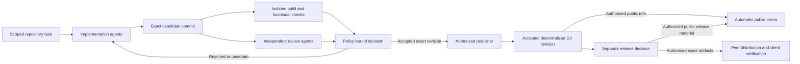

# Cooperative repository maintenance

Development goal agreed on 2026-10-01 and extended on 2026-11-24.

## Outcome

The shared VOLPAROSSA brain should maintain Core and all current and future
VOLPAROSSA repositories through decentralized Git. Peers must be able to propose
and review changes, build and test them, publish authorized revisions and
releases, and deliver verified updates using the DICN. This includes changes
to the maintenance software itself. Routine approved work can proceed
automatically within the powers granted to each participant.

GitHub is the intended automatically updated, replaceable public mirror.
Current GitHub workflows and repository protections govern work there. The
target cycle must work with GitHub, GitHub Actions and other central development
services unavailable.

## Decentralized Git and DICN reuse

Replicate Git objects, accepted refs and the evidence needed to interpret them
across independently operated peers. Retain the review, decision history and
build inputs needed to continue work from another peer. Bind each canonical
revision to the repository's previously authorized governance and decision.
Conflicting heads require verification against that history before publication
continues. Popularity and mirror state confer no authority.

### Source recovery and Radicle

Use a self-contained Git bundle for the first public source-recovery trial.
A reader with an independently selected publisher, signed manifest and expected Git
ref and commit can recover history using ordinary Git and the existing Core
content transport. Bundle prerequisites would require a separate trusted source,
so the fresh-repository trial requires a complete bundle. Check the expected ref
and commit and run Git object validation after retrieval. A fetched repository
supplies source bytes. Approval of a new canonical ref and installation of a
release each require their own decision. [Git bundle format and verification](https://git-scm.com/docs/git-bundle)

Radicle Heartwood addresses a different part of the cycle. Its repository ID
derives from the initial identity document and remains stable across renames.
Delegates and a threshold govern changes. Signed refs bind advertised Git refs
to a peer. Patches, reviews and issues are stored as collaborative Git objects.
These properties make it a candidate for transferring review history along
with source. A plain source-branch bundle omits review objects and delegate
history unless those refs are explicitly included. The reviewed source declares
MIT or Apache-2.0 licensing. [Identity document and visibility](https://github.com/radicle-dev/heartwood/blob/8b053320dc3d5dc2189be3105546ed4d852b0583/crates/radicle/src/identity/doc.rs) · [Signed refs](https://github.com/radicle-dev/heartwood/tree/8b053320dc3d5dc2189be3105546ed4d852b0583/crates/radicle/src/storage/refs/sigrefs) · [Patch objects](https://github.com/radicle-dev/heartwood/blob/8b053320dc3d5dc2189be3105546ed4d852b0583/crates/radicle/src/cob/patch.rs) · [Source licenses](https://github.com/radicle-dev/heartwood/blob/8b053320dc3d5dc2189be3105546ed4d852b0583/Cargo.toml)

Heartwood uses Noise-authenticated peer sessions and disseminates availability
and ref announcements through gossip. For private repositories, delegates and
allowed node identities can obtain the source. An authorized seed holding a
readable repository is a trusted recipient. Before enabling an adapter, verify
which participants can observe repository interests, how the adapter uses the
DICN transport, and whether a fresh node can recover both code and review history
after seed loss. Keep private work out of the public trial. An integration must
map accepted refs to VOLPAROSSA's independently authorized policy, evidence,
release authority and recovery counters. [Radicle protocol and replication](https://radicle.dev/guides/protocol)

Use Network for permitted peer discovery and transport, Storage for encrypted
recovery copies, and existing signed publications and retention for durable
public replicas. Cache serves verified public build inputs and artifacts.
Compute supplies isolated builds, tests and reviews.
Reuse the existing scheduler and Code's scoped workspace tools for real file
reads, edits and checks. Make pinned toolchains, dependencies, build recipes
and declared test inputs obtainable from authorized replicas so one registry,
runner, seed or model service cannot halt the cycle.

## One task, exact authority

Every task must bind the immutable, forge-independent repository ID and enrolling
authority, exact base commit, intended change, permitted paths and tools,
resource budget, privacy class and policy version. Repository names alone are insufficient: renames,
transfers and forks must not silently redirect authority. Bind any mirror's
repository ID separately. Newly discovered repositories require enrollment
under the project's configured policy before agents may act on them.
Unknown repository-specific build instructions do not grant new permissions.

Public source may be assigned to suitable peers. Private repositories, secrets,
issue attachments and tool output remain private unless the owner explicitly
authorizes a compatible execution environment. Reading a public repository does
not authorize uploading a developer's local worktree or unpublished changes.

Code and dependencies are untrusted input. Build and test jobs run in disposable
workspaces without publisher credentials, developer home directories or host
network privileges. Agents do not execute repository instructions as privileged
commands merely because the instructions are present in source or an issue.

## Development and immune review

The decision binds the candidate/base commits, patch and artifact digests, actual
test outcomes, reviewer identities, applicable policy and expiry. A changed
candidate or stale base requires a fresh decision; an endorsement for one commit
does not authorize a different tree or release artifact. Tests supplied by the
author cannot replace independently defined acceptance requirements.

Review must examine the agreed virtues and privacy boundaries as well as actual
correctness, dependency provenance and compatibility with other VOLPAROSSA apps.
The author cannot approve its own change. Several model processes, keys or copies
of one agent do not by themselves establish independent reviewers: authority and
failure-domain rules must resist one participant fabricating a quorum. A model's
positive assessment, signature or green unit test is not proof that code is safe.

Agents can propose improvements to their own maintained source. Such a proposal
cannot change the policy, trusted-reviewer set, credentials or safeguards used to
judge itself. Governance/permission changes require separately authorized
authority, not a repository patch or another model's assertion.
Apply the shared immune review to human and agent proposals, including
cumulative damage across revisions, authorized governance changes and
recovery of compromised components. [Review of proposed changes](DECENTRALIZED_AGENTS.md#review-of-proposed-changes)

## Publication is a separate capability

An authorized publisher revalidates the exact approved revision, base and
repository identity against current policy before advancing the canonical ref.
Use short-lived, repository-scoped credentials and preserve the proposal,
review and authorization record. The publisher has no permission to override
required checks, force-push a default branch, disable protections or expand
its own access. Reconcile duplicate requests with an existing publication and
expose cancellation or failure.

Enable independently operated, previously authorized participants to carry out
publication and release decisions under the applicable thresholds if a publisher
or signing host disappears. Preserve the threshold and independent-review
requirements during failover. Report the affected operation as unavailable if
the remaining participants lack authority.

When a public revision or release is authorized, automatically mirror the
permitted refs and public release material to the configured GitHub repository.
Scope any short-lived GitHub App credentials to that repository and keep them
out of workers and caches. Mirror delay or failure may leave the public view
stale while peers continue development and updates. Reconcile a recovered or
replacement mirror with the verified public revision and artifact digests.
If divergent refs would require overwriting history, report the conflict and
use the configured recovery policy. Mirror-only pushes, PRs and CI statuses
may supply proposals or evidence but cannot advance canonical state.

Release publication is a separate policy action from source merging. Signed
provenance should bind the source, isolated build and exact released bytes.
Provenance identifies an artifact's origin; it does not prove correctness.
Distribution may use VOLPAROSSA cache transport, but cached bytes remain inert
until the client verifies their release authority and eligibility for activation.

## Automatic client updates (explicit user revision, 2026-10-01)

The user subsequently authorized automatic download and installation of
published, approved releases for all VOLPAROSSA clients. This supersedes the
earlier product-wide prohibition on automatic code downloads **only for this
defined update facility**. It is not permission to run arbitrary cached programs,
install model-supplied dependencies or modify the development host today.

Use an established update-verification framework such as TUF, not a new signature
scheme. Start with trusted root metadata provisioned by the original authorized
installation. Separate root, release/targets, snapshot and freshness authority;
scope delegated signing to component/platform/channel. A GitHub commit signature
or an agent's positive review alone is not a release-installation authorization.
Root rotation must be verified using existing trust, not a key advertised by the
candidate being installed. Define recovery for compromised/expired authorities.

The client independently verifies authorized metadata, exact artifact hash and
size, component/platform, freshness/version and compatibility with its shared
daemon before activation. Reject untrusted, expired, mixed-release or downgraded
metadata. Peers distribute bytes without choosing which software is trusted.
Publishers must never acquire authority merely by accumulating peer identities.

Activation needs its own transactional state: staged, verified, eligible,
installing, health-checked, active or failed. Preserve settings, identity keys,
stored fragments and outstanding leases. Drain or checkpoint active work as
needed, and coordinate applications sharing one daemon. Use phased cohorts with
visible status, owner pause/cancellation and a stop condition when health checks
fail; do not automatically force all devices onto the same unproven build at once.
Offline devices update when able, within device capacity and platform constraints.

Retain a previously verified usable release for recovery where its data/schema
compatibility allows it. Recovery must not lower trusted metadata version counters
or permit an arbitrary old vulnerable version; irreversible data migrations need
an explicit compatible recovery strategy. Reinstallation is not a reason to
discard private data or contribution obligations.

Use the platform's authorized installer mechanisms, including store-managed
updates where required. A project updater cannot bypass OS signing, app-store or
administrator requirements. Keep installer authority separate from network/AI
workers and the typed networking helper; never turn the helper into a general
root command executor. No new privileges, telemetry or privacy permissions are
silently granted by an automatic update.

TUF verifies update metadata and downloaded targets; it does not implement the
installer, prove code correctness or supply the rollout/recovery mechanism above.
The exact maintained implementation, artifact formats and platform adapters remain
to be selected and pinned before executable integration.

## Functional verification

The central build chat chooses when to schedule this work within the full goal.
Use disposable multi-peer environments, enrolled test repositories and synthetic
releases to verify each capability before using it for production publication.
Keep public-object admission, independent code review, repository publication,
release signing and client activation separately authorized.

| Scenario | Required observation |
| --- | --- |
| Self-improvement without a central service | With GitHub, Actions and central registries, model endpoints and runners inaccessible, retrieve an enrolled project and pinned inputs from peers. Exercise a scoped change to the maintenance component through Code, independent build and review, accepted Git ref, separate release decision and automatic update on an eligible client. Record matching revisions, decisions and installed digest. |
| Publication under disagreement | Submit a changed candidate, stale base, conflicting decision or replay. Peers retain the last authorized ref and release. An independently approved successor can then advance them within the applicable permissions. |
| Mirror outage and replacement | Keep the mirror unavailable through two accepted revisions and a release. Restore it, then repeat with a replacement destination. Read back the public refs and release digests and confirm that retries converge without duplicates or disclosure of private material. A mirror-only ref cannot become a canonical update. |
| Decentralized recovery | Remove the original publisher and isolate a compromised replica. Recover source, review history, trusted release metadata and artifacts from independent replicas. With sufficient surviving authority, publish a reviewed successor. A fresh client with its provisioned root must verify the eligible release and reject substituted bytes. A previously updated client must reject metadata older than its trusted counters. |
| Activation and owner control | Interrupt a staged update, exercise owner pause and fail the new version's health check. Demonstrate compatible recovery, preserved private state and trust counters, and a subsequent authorized update. |

## Primary integration references

- [GitHub App installation tokens and narrowed repository permissions](https://docs.github.com/en/apps/creating-github-apps/authenticating-with-a-github-app/generating-an-installation-access-token-for-a-github-app)
- [GitHub App security practices](https://docs.github.com/en/apps/creating-github-apps/about-creating-github-apps/best-practices-for-creating-a-github-app)
- [TUF overview and limits](https://theupdateframework.io/docs/overview/)
- [TUF specification: trust, versions and client verification](https://theupdateframework.github.io/specification/latest/)
- [Existing cooperative-agent design](DECENTRALIZED_AGENTS.md)
